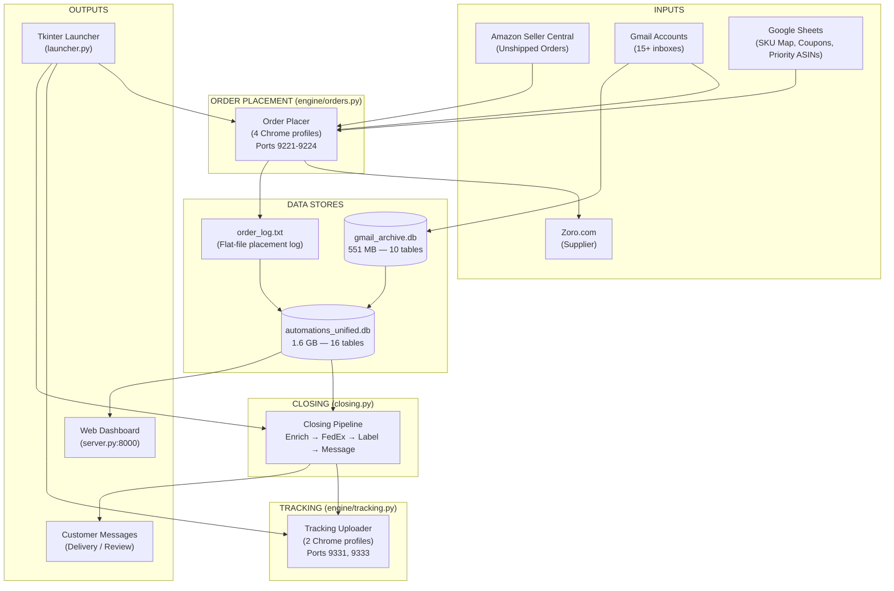
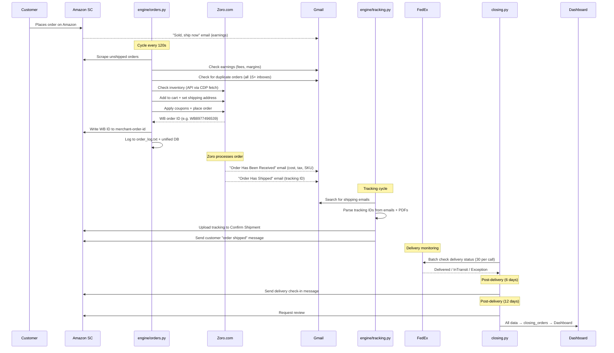

# ZUHRA Software — Complete System Documentation

> **Generated:** Friday, 5 September 2026  
> **Updated:** Monday, 7 September 2026 (Reflecting Cloudflare R2 Layer, Priority ASIN Control Rebuild, and Option A Sheet-Authority Model)  
> **Codebase:** `Automations/` (HOANK STORE + Hathoro Amazon → Zoro Dropshipping)  
> **Total Production Code:** ~38,000+ lines across 55+ Python files

---

## Table of Contents

1. [Business Model Overview](#1-business-model-overview)
2. [System Architecture — The Big Picture](#2-system-architecture--the-big-picture)
3. [Directory Structure — Every File Explained](#3-directory-structure--every-file-explained)
4. [The Order Lifecycle — End to End](#4-the-order-lifecycle--end-to-end)
5. [Module Deep-Dives](#5-module-deep-dives)
6. [Database Architecture — Current State & Bloat Analysis](#6-database-architecture--current-state--bloat-analysis)
7. [Dashboard & Web UI](#7-dashboard--web-ui)
8. [GUI Launcher (ZUHRA Software)](#8-gui-launcher-zuhra-software)
9. [Google Sheets Integration](#9-google-sheets-integration)
10. [Account & Credential Management](#10-account--credential-management)
11. [Business Rules & Logic](#11-business-rules--logic)
12. [Private Label (PL) Listings](#12-private-label-pl-listings)
13. [Identified Gaps & Missing Checks](#13-identified-gaps--missing-checks)
14. [Database Optimization Roadmap](#14-database-optimization-roadmap)
15. [Unified Dashboard Vision](#15-unified-dashboard-vision)

---

## 1. Business Model Overview

### What This System Does

Two Amazon seller accounts (**HOANK STORE** and **Hathoro**) sell industrial supplies sourced from **Zoro.com**. When a customer buys on Amazon, the system automatically purchases the same item from Zoro and has it shipped directly to the Amazon customer (dropshipping).

### The Two Revenue Streams

| Stream | SKU Prefix | Description |
|--------|-----------|-------------|
| **Dropshipping** | Any (mapped in Google Sheet) | Hunt products on Zoro, list on Amazon, auto-place orders via bot |
| **Private Label (PL)** | `HOA*`, `HO*`, `ht*`, `Hath*` | **Still sourced from Zoro** but listed as a new/own-branded product on Amazon. Requires PPC ad spend. The bot handles placement the same way — the only difference is the listing is "ours" and needs marketing |

### The Two Amazon Accounts

| Account | Earnings Gmail | Primary Use |
|---------|---------------|-------------|
| **HOANK STORE** | `qurtdis@gmail.com` | Main dropshipping store |
| **Hathoro** | `abecomllc26@gmail.com` | Second dropshipping store |

### Supplier

**Zoro.com** — Industrial/commercial supplies. Orders placed via 15+ Zoro accounts, across multiple Gmail inboxes. FedEx is the primary carrier.

---

## 2. System Architecture — The Big Picture



### Three Independent Workers

| Worker | Entry Point | What It Does | Runs When |
|--------|------------|--------------|-----------|
| **A — Order Placer** | `engine/orders.py` | Scrapes Amazon SC → places on Zoro → writes WB ID back | Continuous loop (120s cycles) |
| **B — Tracking Uploader** | `engine/tracking.py` | Finds tracking in Gmail → uploads to Amazon SC → sends messages | Continuous loop |
| **C — Closing Pipeline** | `closing.py` | Downloads 30-day report → enriches every field → FedEx check → label → message | On-demand or cron |

---

## 3. Directory Structure — Every File Explained

### Root Level

| File | Size | Purpose |
|------|------|---------|
| [`closing.py`](file:///Users/kamibaloch342/Downloads/Dropshipping/Development_Unit/Automations/closing.py) | 94 KB (1,910 lines) | **Single-file closing pipeline** — the most critical post-placement script. Downloads report, enriches, FedEx-checks, labels, sends messages |
| [`schema_v2.sql`](file:///Users/kamibaloch342/Downloads/Dropshipping/Development_Unit/Automations/schema_v2.sql) | 9 KB | Clean relational schema definition (5 tables: closing_orders, amazon_order_details, order_messages, order_returns, order_feedback) |
| [`bot_config.json`](file:///Users/kamibaloch342/Downloads/Dropshipping/Development_Unit/Automations/bot_config.json) | 1.5 KB | Live runtime configuration — profiles, margins, velocity, blocked orders |
| [`walmart_orders.py`](file:///Users/kamibaloch342/Downloads/Dropshipping/Development_Unit/Automations/walmart_orders.py) | 86 KB | Walmart Seller Center → Zoro pipeline (separate marketplace) |
| [`delete_listing.py`](file:///Users/kamibaloch342/Downloads/Dropshipping/Development_Unit/Automations/delete_listing.py) | 4 KB | Bulk listing deletion from Amazon SC |
| [`requirements.txt`](file:///Users/kamibaloch342/Downloads/Dropshipping/Development_Unit/Automations/requirements.txt) | 389 B | Python dependencies |
| [`Start_Windows.bat`](file:///Users/kamibaloch342/Downloads/Dropshipping/Development_Unit/Automations/Start_Windows.bat) | 1.6 KB | Windows startup script |

---

### `engine/` — Core Business Logic (~17,000 lines)

| File | Lines | Purpose |
|------|-------|---------|
| [`orders.py`](file:///Users/kamibaloch342/Downloads/Dropshipping/Development_Unit/Automations/engine/orders.py) | 4,262 | **The Order Placer** — scrapes Amazon SC orders page, validates address, checks Zoro inventory, applies coupons, places order, writes WB ID back. Supports all 4 profiles |
| [`tracking.py`](file:///Users/kamibaloch342/Downloads/Dropshipping/Development_Unit/Automations/engine/tracking.py) | 1,899 | **Tracking Uploader** — searches Gmail for Zoro shipping emails, parses tracking IDs (FedEx 12-digit, UPS), uploads to Amazon SC Confirm Shipment page. Multi-package support |
| [`coupons.py`](file:///Users/kamibaloch342/Downloads/Dropshipping/Development_Unit/Automations/engine/coupons.py) | 1,225 | **Coupon Generator** — creates temp email via mail.tm → signs up on Zoro → polls for confirmation → extracts coupon code → uploads to Google Sheet |
| [`post_delivery.py`](file:///Users/kamibaloch342/Downloads/Dropshipping/Development_Unit/Automations/engine/post_delivery.py) | 915 | **Post-Delivery Actions** — delivery check-in message (6+ days), review request (12+ days), return/refund detection, customer inquiry detection |
| [`fedex_api.py`](file:///Users/kamibaloch342/Downloads/Dropshipping/Development_Unit/Automations/engine/fedex_api.py) | 703 | **FedEx Tracker** — 3-tier: (1) Official REST API, (2) Headless Chrome CDP batch, (3) DOM scraper fallback |
| [`listings.py`](file:///Users/kamibaloch342/Downloads/Dropshipping/Development_Unit/Automations/engine/listings.py) | 691 | **Listing Health Engine** — cross-references ALR + Order Reports + Zoro catalog. Detects: redundant, OOS, back-in-stock, dead-but-sold |
| [`closing_pipeline.py`](file:///Users/kamibaloch342/Downloads/Dropshipping/Development_Unit/Automations/engine/closing_pipeline.py) | 653 | **Worker B** — enriches `order_placer_orders` → `closing_orders` via archive tables |
| [`amazon_scraper.py`](file:///Users/kamibaloch342/Downloads/Dropshipping/Development_Unit/Automations/engine/amazon_scraper.py) | 736 | **SC Page Scraper** — extracts rich order detail: buyer info, full address, shipping service, financials, payment method |
| [`live_gmail_per_order.py`](file:///Users/kamibaloch342/Downloads/Dropshipping/Development_Unit/Automations/engine/live_gmail_per_order.py) | 521 | **Live Gmail Fallback** — when archive misses data, searches live Gmail per order for: earnings, zoro cost, tracking, returns, messages |
| [`live_gmail_enrichment.py`](file:///Users/kamibaloch342/Downloads/Dropshipping/Development_Unit/Automations/engine/live_gmail_enrichment.py) | ~500 | Batch live Gmail enrichment for recent orders |
| [`fedex_tracker.py`](file:///Users/kamibaloch342/Downloads/Dropshipping/Development_Unit/Automations/engine/fedex_tracker.py) | ~400 | FedEx batch tracking runner for closing pipeline |
| [`closing_signals.py`](file:///Users/kamibaloch342/Downloads/Dropshipping/Development_Unit/Automations/engine/closing_signals.py) | 190 | Cross-module signal flags (e.g. abort, skip-fedex) |
| [`walmart_sc.py`](file:///Users/kamibaloch342/Downloads/Dropshipping/Development_Unit/Automations/engine/walmart_sc.py) | ~700 | Walmart Seller Center scraper |

---

### `checkout/` — Zoro Checkout Flow (~3,700 lines)

| File | Lines | Purpose |
|------|-------|---------|
| [`dom.py`](file:///Users/kamibaloch342/Downloads/Dropshipping/Development_Unit/Automations/checkout/dom.py) | 2,111 | **DOM-based checkout** — handles two Zoro UI layouts (old text-input vs new dropdown coupons). Address verification → coupon application → payment switching → PO number → place order → confirmation |
| [`true_api.py`](file:///Users/kamibaloch342/Downloads/Dropshipping/Development_Unit/Automations/checkout/true_api.py) | 1,533 | **True REST API checkout** — uses CDP-captured endpoints. Inventory → Cart → Address → Shipping → Coupon → Payment → Order Submit. 100% API, no DOM |
| [`api.py`](file:///Users/kamibaloch342/Downloads/Dropshipping/Development_Unit/Automations/checkout/api.py) | ~700 | Low-level Zoro API helpers |

---

### `platforms/` — External Service Adapters

| File | Lines | Purpose |
|------|-------|---------|
| [`amazon.py`](file:///Users/kamibaloch342/Downloads/Dropshipping/Development_Unit/Automations/platforms/amazon.py) | ~660 | Amazon SC operations: download report, scrape address, validate/normalize address, update seller ID (WB write-back), write seller notes |
| [`zoro.py`](file:///Users/kamibaloch342/Downloads/Dropshipping/Development_Unit/Automations/platforms/zoro.py) | ~680 | Zoro API: inventory check, cart operations, address CRUD, DataDome recovery. All via in-browser `fetch()` calls |
| [`gmail.py`](file:///Users/kamibaloch342/Downloads/Dropshipping/Development_Unit/Automations/platforms/gmail.py) | ~500 | Gmail integration: OAuth2 auth, earnings lookup, duplicate detection |
| [`auth.py`](file:///Users/kamibaloch342/Downloads/Dropshipping/Development_Unit/Automations/platforms/auth.py) | ~330 | Amazon SC auto-login with TOTP 2FA |

---

### `utils/` — Shared Utilities

| File | Lines | Purpose |
|------|-------|---------|
| [`unified_db.py`](file:///Users/kamibaloch342/Downloads/Dropshipping/Development_Unit/Automations/utils/unified_db.py) | 1,134 | **Central database layer** — schema (16 tables), connection helpers, CRUD for all tables, stat queries |
| [`config.py`](file:///Users/kamibaloch342/Downloads/Dropshipping/Development_Unit/Automations/utils/config.py) | 464 | **All configuration** — profiles, ports, selectors, margins, billing addresses, Google Sheets, state maps |
| [`helpers.py`](file:///Users/kamibaloch342/Downloads/Dropshipping/Development_Unit/Automations/utils/helpers.py) | 769 | Browser setup, CDP stealth injection, human simulation, CSV helpers, coupon cache, Chrome memory-softening |
| [`sheet_sync.py`](file:///Users/kamibaloch342/Downloads/Dropshipping/Development_Unit/Automations/utils/sheet_sync.py) | 837 | Background sync of order_log.txt → Google Sheets Order_Log tab (40 columns) |
| [`placement_lock.py`](file:///Users/kamibaloch342/Downloads/Dropshipping/Development_Unit/Automations/utils/placement_lock.py) | 454 | **Hard dedup lock** — prevents duplicate orders. RESERVE before payment → CONFIRM/RELEASE after outcome. Born from the $11.7k duplicate incident |
| [`seller_notes.py`](file:///Users/kamibaloch342/Downloads/Dropshipping/Development_Unit/Automations/utils/seller_notes.py) | 425 | Formats seller notes with profit data, PI suggestions. Max 230 chars (Amazon limit 256) |
| [`accounts_config.py`](file:///Users/kamibaloch342/Downloads/Dropshipping/Development_Unit/Automations/utils/accounts_config.py) | 166 | Loads `config/accounts.json` — THE single source of truth for all account/inbox lists |
| [`pricing.py`](file:///Users/kamibaloch342/Downloads/Dropshipping/Development_Unit/Automations/utils/pricing.py) | ~80 | Price/status logging per Zoro SKU |
| [`dup_check_local.py`](file:///Users/kamibaloch342/Downloads/Dropshipping/Development_Unit/Automations/utils/dup_check_local.py) | ~130 | Local file-based duplicate check |
| [`gmail_archive_reader.py`](file:///Users/kamibaloch342/Downloads/Dropshipping/Development_Unit/Automations/utils/gmail_archive_reader.py) | ~320 | Reads gmail_archive.db for enrichment |
| [`proc.py`](file:///Users/kamibaloch342/Downloads/Dropshipping/Development_Unit/Automations/utils/proc.py) | ~85 | Process management helpers |
| [`check_sheet_size.py`](file:///Users/kamibaloch342/Downloads/Dropshipping/Development_Unit/Automations/utils/check_sheet_size.py) | ~30 | Google Sheets size checker |

---

### `gmail_fetch/` — Gmail Archive Builder

| File | Lines | Purpose |
|------|-------|---------|
| [`gmail_archive.py`](file:///Users/kamibaloch342/Downloads/Dropshipping/Development_Unit/Automations/gmail_fetch/gmail_archive.py) | 1,625 | **Comprehensive Gmail archiver** — bulk build + incremental sync. Extracts earnings, zoro orders, tracking, receipts, returns, refunds, buyer inquiries, seller messages |
| [`build_gmail_archive.py`](file:///Users/kamibaloch342/Downloads/Dropshipping/Development_Unit/Automations/gmail_fetch/build_gmail_archive.py) | ~220 | One-shot bulk archive builder |
| [`utils.py`](file:///Users/kamibaloch342/Downloads/Dropshipping/Development_Unit/Automations/gmail_fetch/utils.py) | ~680 | Gmail fetch utilities, email body parsing |
| [`config.py`](file:///Users/kamibaloch342/Downloads/Dropshipping/Development_Unit/Automations/gmail_fetch/config.py) | ~85 | Gmail fetch config |

---

### `dashboard/` — Web Dashboard

| File | Lines | Purpose |
|------|-------|---------|
| [`server.py`](file:///Users/kamibaloch342/Downloads/Dropshipping/Development_Unit/Automations/dashboard/server.py) | 2,197 | **Dashboard API server** — stdlib HTTP. KPIs, ASIN analysis, orders, insights, CRM, P&L, repricer. Password-gated (admin + viewer roles) |
| [`index.html`](file:///Users/kamibaloch342/Downloads/Dropshipping/Development_Unit/Automations/dashboard/index.html) | 185 KB | Single-page frontend (HTML + JS + CSS) |
| [`analytics.py`](file:///Users/kamibaloch342/Downloads/Dropshipping/Development_Unit/Automations/dashboard/analytics.py) | ~1,000 | Analytics engine — ASIN performance, profit trends, margin distribution |
| [`insights.py`](file:///Users/kamibaloch342/Downloads/Dropshipping/Development_Unit/Automations/dashboard/insights.py) | ~640 | Insights engine — detects zoro code changes, price changes, handling time changes, shipping anomalies |
| [`repricer_engine.py`](file:///Users/kamibaloch342/Downloads/Dropshipping/Development_Unit/Automations/dashboard/repricer_engine.py) | ~500 | Repricer — loads Amazon offers report, identifies repricing opportunities |
| [`migrate_crm.py`](file:///Users/kamibaloch342/Downloads/Dropshipping/Development_Unit/Automations/dashboard/migrate_crm.py) | ~100 | CRM migration helper |

---

### `gui/` — Tkinter Launcher

| File | Lines | Purpose |
|------|-------|---------|
| [`launcher.py`](file:///Users/kamibaloch342/Downloads/Dropshipping/Development_Unit/Automations/gui/launcher.py) | 4,417 | **ZUHRA Software v4** — full-page dashboard with sidebar navigation. Manages Chrome profiles, spawns workers, live config editing, console output, closing, tracking, coupons, listings, walmart |

---

### `scripts/` — 77 Utility Scripts

Key scripts (grouped by function):

**Sync & Backfill:**
- `sync_order_placer_logs.py` — order_log.txt → DB (every 5 min)
- `sync_gmail_archive.py` — gmail_archive.db → archive_* tables (nightly)
- `backfill_2026.py`, `backfill_from_archive.py`, `backfill_closing_from_archive.py` — historical gap-fill
- `auto_sync_10min.py` — 10-minute auto-sync daemon

**FedEx & Delivery:**
- `fedex_recheck.py` — re-check delivery status for in-transit orders
- `send_delivery_messages.py` — send post-delivery customer messages

**Reports & Analysis:**
- `generate_hoank_offers_report.py`, `generate_hathoro_offers_report.py` — Amazon offers scraping
- `daily_bulk.py` — daily bulk operations
- `reconcile_and_reenrich.py` — reconcile placer vs closing data

**Maintenance:**
- `migrate_unified_db.py` — DB schema migrations
- `repair_mislabeled_wb.py` — fix mis-labelled WB orders
- `repair_multibox_tracking.py` — fix multi-package tracking
- `recompute_split_costs.py` — recalculate split order costs

**Infrastructure:**
- `start_dashboard.py` — start dashboard server
- `dashboard_keeper.py`, `dashboard_watchdog.py` — keep dashboard alive
- `localtunnel.sh`, `public_tunnel.sh`, `start_tunnel.sh` — expose dashboard remotely
- `install_mac_autostart.py`, `install_dashboard_autostart.py` — launchd/systemd setup
- `windows_bootstrap.py` — Windows environment setup
- `travel_mode.py` — mobile-friendly operations mode

---

### `private_label/` — PL Listing Tools

Contains image generation and listing creation tools for the private label business:
- `build_hoank_listings.py` — create Amazon listings from templates
- `fill_shipping_box_template.py`, `fill_storage_bag_template.py` — product image templating
- `finalize_ai_images.py`, `make_stack_composites.py` — AI-generated product images

---

### `TSV Files/` — Zoro Supplier Catalog

| File | Size | Purpose |
|------|------|---------|
| `auto_download.py` | 8.5 KB | S3 sync → downloads Zoro datafeeds → builds SQLite |
| `build_zoro_db.py` | 4 KB | TSV → SQLite ingestion |
| `combined_reports.db` | 1.2 GB | Full Zoro catalog (zoro_data table: SKU, price, stock, lead time) |
| `export_cleaning_excel.py` | 8 KB | Query & export specific categories (e.g. cleaning supplies) |
| `zoro_datafeed_00.tsv` | 616 MB | Raw supplier feed part 1 |
| `zoro_datafeed_01.tsv` | 617 MB | Raw supplier feed part 2 |

---

## 4. The Order Lifecycle — End to End



### Order Status Codes Written to Amazon

| Code | Meaning |
|------|---------|
| `WB-12345678` | Successfully placed on Zoro (WB = Web Order) |
| `OOS` | Out of stock on Zoro |
| `Discontinued` | Item removed from Zoro |
| `Loss` | Margin below threshold |
| `Duplicate` | Already ordered (detected via Gmail or placement lock) |
| `Restricted` | State restriction (HI, AK, PR) |
| `ALT:G123456` | Placed using alternate Zoro code (original OOS) |

---

## 5. Module Deep-Dives

### 5.1 Order Placer — `engine/orders.py` (4,262 lines)

**The brain of the operation.** Runs in a continuous loop, one profile at a time.

#### Profile System

| Profile | Port | Account | Zoro Payment | Label Filter |
|---------|------|---------|-------------|-------------|
| `DM_COUPON` | 9221 | Hathoro | Coupon + Credit Card | MR |
| `DM_RESELLER` | 9222 | Hathoro | Credit Card (NO Net30) | AB ECOM |
| `HS_COUPON` | 9223 | HOANK | Coupon + Credit Card | MR |
| `HS_RESELLER` | 9224 | HOANK | Credit Card / Net30 | RAJAR |

#### ASIN Mapping — The Gatekeeper

**The bot ONLY places orders for ASINs that are mapped in the Google Sheet.** The team lists products on Amazon, and then maps each ASIN → Zoro SKU (with qty multiplier) in the `Verified_SKU_Dataset` tab. Unmapped ASINs are flagged on the dashboard as **"Unmapped / Needs Priority"** — the bot never touches them.

**Evolution of placement controls (in order they were introduced):**
1. **ASIN → SKU Mapping** (Google Sheet) — defines WHAT to place and with which Zoro code
2. **Priority ASIN Control** (Google Sheet tab) — defines WHICH ASINs to place FIRST
3. **Profit Threshold** (bot_config.json `min_margin`) — defines the minimum acceptable margin
4. **Labelling System** (Amazon merchant-order-id) — WB/OOS/Loss/Duplicate/Restricted codes
5. **Locked Orders** (bot_config.json `blocked_order_ids`) — hard-block specific order IDs
6. **Placement Lock** (`placement_lock.py`) — atomic dedup to prevent the $11.7k incident

#### Per-Order Flow

1. **Load SKU dataset** from Google Sheets (`Verified_SKU_Dataset` tab)
2. **Check Priority ASIN Control** — process priority ASINs first
3. **Scrape Amazon SC** orders page for unshipped orders matching target label
4. **For each order:**
   - **Skip if ASIN is unmapped** (not in Google Sheet) → flagged on dashboard
   - Check placement lock (FAIL-CLOSED — if lock unavailable, refuse to place)
   - Scrape full shipping address from Amazon order page
   - Normalize state (e.g. "Washington" → "WA", "DC" → "DC")
   - Block if state in `[PR, HI, AK]` (Zoro doesn't ship there)
   - Get earnings from Gmail ("Sold, ship now" email)
   - Check ALL 15+ Gmail inboxes for duplicates (fail-closed on error)
   - Check Zoro inventory via API — get price, stock status
   - Calculate margin: `(earnings - zoro_cost) / zoro_cost`
   - Apply profit threshold (configurable per profile, typically -5% to -20%)
   - If cart subtotal < $50: add shipping filler SKU (G500699916, $0.71) to avoid $5.99 small-order fee
   - Apply coupons (try priority coupons first, then from Google Sheet)
   - Set PO number = Amazon Order ID
   - Place order (API-first for reseller, DOM fallback for coupon)
   - Extract WB order ID from confirmation page
   - Write WB ID back to Amazon merchant-order-id field
   - Write formatted seller note (profit, margin, PI suggestion)
   - Log everything to `order_log.txt` + sync to DB + Google Sheet

#### 5.1.1 Priority ASIN Control & Dynamic Profile Routing (Reseller vs. Coupon)

##### The Business Rationale & Profile Economics
The fulfillment operation runs on **two distinct Zoro account profile types**, each with strict financial tradeoffs:

1. **RESELLER Profile**:
   - **Blind Packaging**: Orders ship with neutral packing slips without Zoro branding or pricing receipts (essential for Amazon dropshipping customer experience).
   - **No Promo Codes**: Zoro explicitly disables promotional coupon codes on verified reseller accounts.
   - **The Zoro Select Advantage**: On all **"Zoro Select" products**, Zoro automatically grants a built-in **10% discount** at checkout without needing any coupon code.
2. **COUPON Profile**:
   - **Coupon Enabled**: Normal Zoro accounts that support applying promotional discount codes.
   - **Maximum Profit Target**: The primary business directive is to place orders through Coupon profiles wherever possible to capture a 10% (or greater) discount on the entire cart.
   - **Coupon Scarcity**: Standard 10% coupons are single-use and limited in supply (the team cannot generate hundreds of fresh 10% coupons daily).

---

##### The Core Value & Profit Threshold Rules
To prevent burning scarce single-use coupons on low-dollar orders:
- **Purchasing Total $\ge \$50$ $\to$ Route to COUPON**:
  - A 10% discount on $\$50+$ saves $\ge \$5.00$ per order, making it an efficient use of a coupon.
- **Purchasing Total $< \$50$ $\to$ Route to RESELLER**:
  - Applying a limited 10% coupon to a $\$10$ order only saves $\$1.00$—a wasteful burn of a scarce coupon code.
- **The Low-Margin Exception ($< 5\%$ Profit)**:
  - If purchasing cost is $< \$50$, but the projected profit margin on Reseller is **less than 5%**, the order is forced to **COUPON profile** (so the 10% discount prevents the order from executing at a financial loss).

---

##### The Weekly Rotating "Priority Coupons" (e.g., `FACILITY`, `CLEAN10`)
Every Monday, Zoro releases rotating brand/category coupons (called **Priority Coupons**):
- **Superpower**: Priority coupons are **reusable across unlimited orders** for that entire week (saving scarce single-use 10% coupons).
- **Limitation**: They only apply to specific categories, brands, or product lines.
- **Brand Exclusions ("Promo Ineligible")**: Brands like Milwaukee, DeWalt, Fluke, etc., carry a strict Zoro restriction: *"This item is not eligible for promotional discounts"*. Promo-ineligible items can NEVER take a coupon and must **100% route to RESELLER**.

---

##### The Monday Sorting Matrix (The 100-ASIN Example)
When a new priority coupon (e.g., `FACILITY`) arrives on Monday, the order queue is tested across active ASINs:

```
                                      [100 ASINs with Orders]
                                                 │
                        ┌────────────────────────┴────────────────────────┐
                        ▼                                                 ▼
             [50 ASINs: FACILITY Works]                        [50 ASINs: FACILITY Fails]
                        │                                                 │
                        ▼                                ┌────────────────┴────────────────┐
                 COUPON PROFILE                          ▼                                 ▼
           (Uses reusable FACILITY)               [Purchasing < $50]               [Purchasing ≥ $50]
                                                  (and Profit ≥ 5%)                        │
                                                         │                                 ▼
                                          ┌──────────────┴──────────────┐            COUPON PROFILE
                                          ▼                             ▼           (Standard 10% Code:
                                   [20 Zoro Select]            [5 Non-Zoro Select]    Saves ≥ $5.00)
                                          │                             │
                                          ▼                             ▼
                                   RESELLER PROFILE               DECIDING MODE
                                  (Auto 10% discount,         (Qty=1: <$50 → Reseller;
                                   blind packaging)            Qty≥2: ≥$50 → COUPON!)
```

* **Zoro Select ($< \$50$)**: Already gets 10% automatically on Reseller $\to$ Stays on **RESELLER** (applying a standard coupon on Coupon profile would give the exact same 10%, wasting a code).
* **Non-Zoro Select ($< \$50$) — The Multiple Quantity Trap**:
  - At Qty = 1, Zoro purchase is $< \$50 \to$ Reseller.
  - **BUT if an Amazon customer orders Qty $\ge 2$**, the purchasing cost crosses **$\ge \$50$**! Once total purchase is $\ge \$50$, routing to Reseller leaves $\$5+$ on the table.
  - Therefore, Non-Zoro Select items CANNOT be statically hardcoded to Reseller; they must be tagged as **DECIDING MODE** so the bot dynamically checks `order_qty * unit_price` on every single order!

---

##### The Mid-Week Operational Problem: Dynamic Ingestion of Order #101
* **The Flaw of Static Monday Batches**:
  - The script sorts the Monday batch into `Priority_ASIN_Control` in Google Sheets.
  - On Monday night or Tuesday, new orders arrive for **ASIN 101** (never seen before, unmapped in `Priority_ASIN_Control`).
  - The launcher extracts orders for pre-sorted ASINs first. Unsorted orders are stalled as *"UNLABELLED / NEED ACTION"*, forcing the human operator to manually test coupons and assign columns.
* **The Autonomous Solution (Dynamic On-The-Fly Ingestion)**:
  1. If an incoming order's ASIN is **NOT** in `Priority_ASIN_Control`:
     - Verify it is mapped in `Verified_SKU_Dataset` (base mapping check).
     - Check known promo-ineligibility from `coupon_intel.json`. If ineligible $\to$ Route to **RESELLER**.
     - Perform a live background probe of the active weekly priority coupon (`FACILITY`). If it works $\to$ Route to **COUPON**.
     - If priority coupon fails: evaluate `unit_cost * order_qty` vs. Zoro Select status $\to$ Route to **COUPON** ($\ge \$50$) or **RESELLER** ($< \$50$).
     - **Auto-Persist**: Automatically append the learned verdict to `Priority_ASIN_Control` so future orders for ASIN 101 are pre-routed without manual intervention.

---

##### The Monday Weekly Reset & Expiry Lifecycle (Option A: Full Sheet Wipe & Re-evaluation)
* **The Expiry Event**: Every Sunday midnight, Zoro's weekly priority coupon expires (`FACILITY` expires, replaced on Monday morning by e.g. `SUPPLY15` or `WORK20`).
* **Why Option A (Full Wipe & Re-test) Is Strictly Required**:
  1. **Zoro Select Margin Optimization (15–20% vs. 10%)**: Under normal circumstances, Zoro Select products get an automatic 10% discount on the Reseller profile with blind packaging. A standard 10% coupon on the Coupon profile offers no advantage. **However, weekly priority coupons offer 15% or 20% discounts**. A 15% or 20% coupon beats the Reseller 10% auto-discount and yields 5% to 10% more margin! Leaving Zoro Select items stranded in Reseller without re-testing costs the business hundreds of dollars weekly. Therefore, Zoro Select products MUST be re-evaluated whenever a new priority coupon arrives.
  2. **Preventing Failed Checkouts**: Any ASIN that was promoted to the Coupon profile specifically because of the previous coupon will fail checkout once that coupon expires.
* **The Reset Architecture**:
  1. **Sheet Wipe**: The operator clears the ASIN columns (`HS_Coupon`, `DM_Coupon`, etc.) and/or the `Check_*` block in Google Sheets, or triggers "Reset & Rebuild" from the dashboard.
  2. **Anti-Caching Guarantee (Google Sheets Is Master)**:
     - The placer loads priority ASINs directly from the Google Sheets API every cycle (`_load_asin_column_from_sheet`). When the sheet column is wiped, the placer immediately receives `[]` and clears `_LAST_PRIORITY_ASINS[:] = []`. Local memory CANNOT override an empty sheet.
     - The background verifier (`engine/priority_check.py`) inspects the Google Sheet `Check_*` block. If the operator wiped the sheet or deleted an ASIN's check row, the engine immediately detects it, purges the local non-permanent verdict cache via `clear_verdicts(keep_permanent=True)`, and forces a fresh test. Local JSON files CAN NEVER block or resurrect wiped ASINs.
  3. **Permanent Brand Ineligibility Preserved**: Only true manufacturer-level brand exclusions (**Milwaukee, DeWalt, Fluke**) that strictly forbid all promotional codes on Zoro remain permanently in `PROMO_INELIGIBLE`. Everything else is re-evaluated.
  4. **Dynamic On-the-Fly Re-population**: As new coupons arrive, `engine/priority_check.py` autonomously probes cart viability with the new weekly code, placing working ASINs into Coupon and non-working items into Reseller / Deciding mode.

---

##### Real-Time Zoro Page/API Analysis for "Promo Ineligible"
During order checkout and cart testing:
- **DOM Indicator**: Inspection of `.promo-ineligible-badge`, text containing `"This item is not eligible for promotional discounts"` or `"Excluded from promotional offers"`.
- **API Payload Indicator**: Item response in `PUT /v1/cart/{cartId}/promo` returning error `PROMO_NOT_APPLICABLE_TO_ITEMS` or item property `promoEligible: false`.
- **Autonomous Learning**: When this error occurs, immediately record the Zoro SKU / ASIN into `data/dataset/coupon_intel.json` under `promo_ineligible_asins` and append to the Google Sheet `Promo_Ineligible` column. Never attempt coupons on that ASIN again.

#### Safety Mechanisms

- **Placement Lock** (`placement_lock.py`): RESERVE → CONFIRM/RELEASE. Prevents the $11.7k duplicate incident from ever recurring
- **Safety cap**: Max 300 orders per cycle (hard backstop even if config says unlimited)
- **Code staleness detector**: Warns if `orders.py` on disk is newer than the running process
- **Fail-closed duplicate check**: Gmail search error → refuse to place (not "no duplicate found")

---

### 5.2 Tracking Uploader — `engine/tracking.py` (1,899 lines)

#### Flow

1. Authenticate 8 Gmail accounts
2. Search each for Zoro "Your Order Has Shipped" emails
3. Parse tracking IDs:
   - From email body text (regex: 12-digit FedEx numbers)
   - From PDF attachments via `pdfplumber`
4. Match WB order ID → Amazon order ID (via order_log.txt or DB)
5. Navigate to Amazon SC Confirm Shipment page
6. Handle multi-package orders:
   - Click "Add a Shipment" for each additional tracking ID
   - Set quantity per package
   - Select carrier (FedEx) and service class
7. Send customer messages (Amazon's contact reason in brackets — 27 Oct 2026):
   - **Tracking confirmation** — order shipped with tracking link [**Other** only; never "Notify of a
     problem", which filed every shipped message as a shipping problem until then]
   - **Stock delay** — item backordered, expected ship date [Notify of a problem → Other]
   - **Cancel denial** — order already shipped [Other → Notify of a problem]
8. Persist to `message_log.json` and `tracking_upload_log.json`

#### Multi-Package Tracking Support

When Zoro splits an order into multiple shipments:
- Each shipment gets its own tracking email
- The system creates multiple shipment entries on the Amazon Confirm Shipment page
- Quantities are distributed across packages

---

### 5.3 Closing Pipeline — `closing.py` (1,910 lines)

**The reconciler.** Ensures every order has complete data.

#### Execution Modes

| Mode | Trigger | What It Does |
|------|---------|-------------|
| Default | `python closing.py` | 30-day report → enrich all WB orders |
| Manual Report | `CLOSING_MANUAL_REPORT=1` | You download the report, closing picks it up |
| Reuse Report | `CLOSING_REPORT=/path` | Use an existing downloaded report |
| Dry Run | `CLOSING_DRY_RUN=1` | Enrich but don't persist |
| FedEx Only | `CLOSING_FEDEX=1 CLOSING_LIMIT=0` | Only check FedEx delivery status |
| Messages Only | `CLOSING_MESSAGES=1` | Only send post-delivery messages |

#### Enrichment Chain (per order, in priority order)

```
1. ORDER PLACER LOG (order_log.txt / order_placer_orders)
   └─ earnings, zoro_cost, ship_address, coupon_used, profile

2. GMAIL ARCHIVE (archive_* tables)
   └─ earnings, zoro_cost, tracking_ids, returns, messages

3. LIVE GMAIL (per-order API search, if archive missed anything)
   └─ Same fields as archive, but real-time

4. AMAZON SC SCRAPE (optional, if enabled)
   └─ purchase_date, ship_by_date, deliver_by_date, buyer_name

5. FEDEX API (batch of 30)
   └─ delivery_status, delivery_date, signed_by, left_at, scan history

6. PROFIT CALCULATION
   └─ profit = earnings - zoro_total
   └─ percent = (profit / zoro_total) × 100

7. LABEL DETERMINATION
   └─ Completed: has earnings + zoro_total + tracking + Delivered
   └─ Cancelled: return_requested = Yes AND refund_done = Yes
   └─ Incomplete: anything else

8. POST-DELIVERY ACTIONS
   └─ 6+ days after delivery → send check-in message
   └─ 12+ days after delivery → request review
   └─ 3+ days past deliver-by, still in transit → transit alert
```

---

### 5.4 FedEx Tracker — `engine/fedex_api.py` (703 lines)

Three-tier tracking system:

| Tier | Method | Reliability | Speed |
|------|--------|------------|-------|
| **Tier 1** | Official FedEx REST API (`apis.fedex.com`) | 100% | Instant |
| **Tier 2** | Headless Chrome CDP batch (`wtrk/track` fetch) | ~95% | Fast |
| **Tier 3** | DOM scraper (FedEx website polling) | ~80% | Slow |

Falls through tiers automatically. Batch size: 30 tracking IDs per call.

#### Extracted Data Per Tracking ID

| Field | Description |
|-------|-------------|
| `delivery_status` | Delivered / InTransit / Exception / Cancelled |
| `delivery_date` | Actual delivery timestamp |
| `estimated_window` | Estimated delivery window |
| `last_scan_location` | Last FedEx scan location |
| `last_scan_time` | Last scan timestamp |
| `signed_by` | Who signed for delivery |
| `left_at` | Where package was left (e.g. "Front door") |
| `delivery_note` | Special delivery notes |
| `delivery_from` / `delivery_to` | Ship from / to locations |

---

### 5.5 Checkout System — `checkout/` (~3,700 lines)

#### Two Checkout Engines

**DOM-based (`dom.py`):**
- Navigates Zoro checkout page via Selenium
- Handles two distinct UI layouts (old text-input vs new dropdown)
- Auto-detects layout and uses correct selectors
- Address modal handling with validation
- Coupon application with old/new UI detection
- Payment method switching between stored cards
- PO number entry
- Place Order click with retry logic
- Confirmation page detection

**True API (`true_api.py`):**
- Uses CDP-captured REST endpoints directly
- No DOM manipulation needed
- Endpoints: Inventory → Cart → Address → Shipping → Coupon → Payment → Order Submit
- Used for RESELLER profiles (full API end-to-end)
- Coupon profiles fall back to DOM for "Place Order" button

---

## 6. Database Architecture — Current State & Bloat Analysis

### Three Databases

| Database | Size | Purpose |
|----------|------|---------|
| `data/automations_unified.db` | **1.6 GB** | Central unified database — 16 tables |
| `data/gmail_archive.db` | **551 MB** | Gmail email archive (10 tables) |
| `data/dashboard_slim.db` | **119 MB** | Dashboard-specific views |

> [!CAUTION]
> **The 1.6 GB unified DB is storing ~500 MB of raw email body snippets (`raw_body_snippet` columns).** This is the #1 cause of bloat. A text-only order database with 64K orders should be under 50 MB.

### Table Counts (automations_unified.db)

| Table | Rows | Size (Bytes) | Purpose |
|-------|------|-------------|---------|
| `archive_zoro` | 159,471 | **638 MB** 🔴 | Zoro order emails — `raw_body_snippet` alone = 302 MB |
| `enrichment_log` | **1,759,158** | **210 MB** 🔴 | Every field change ever logged — MASSIVE bloat |
| `archive_messages` | 92,862 | **163 MB** 🟡 | Buyer-seller messages — raw snippets = 42 MB |
| `archive_earnings` | 186,732 | **144 MB** 🟡 | "Sold ship now" emails — raw snippets = 74 MB |
| `archive_tracking` | 158,117 | **144 MB** 🟡 | Shipped emails — raw snippets = 52 MB |
| `closing_orders` | 64,214 | **85 MB** | THE source of truth table |
| `archive_returns` | 14,836 | **39 MB** | Return/refund emails — raw snippets = 25 MB |
| `enrichment_log indexes` | — | **154 MB** 🔴 | 3 indexes on enrichment_log |
| `order_placer_orders` | 45,509 | **23 MB** | Placement log |
| `orders` | 33,783 | **14 MB** | Legacy orders table |
| `audit_log` | 66,888 | **7 MB** | Field change audit |
| `placer_claims` | — | **6 MB** | Placement lock (dedup) |

### Root Causes of Bloat

1. **`raw_body_snippet` columns** — Every archive table stores the full email body HTML/text. Total: **~495 MB** of raw email content sitting in every row
2. **`enrichment_log` with 1.76M rows** — Every single field change across every closing run is logged. 210 MB of data + 154 MB of indexes = **364 MB** for audit trails you'll never read
3. **No data retention policy** — Everything since day 1 is kept forever
4. **No VACUUM** — SQLite doesn't reclaim space from deleted rows without explicit VACUUM

---

## 7. Dashboard & Web UI

### Architecture

- **Backend:** [`dashboard/server.py`](file:///Users/kamibaloch342/Downloads/Dropshipping/Development_Unit/Automations/dashboard/server.py) — Python stdlib `ThreadingHTTPServer` on port 8000
- **Frontend:** [`dashboard/index.html`](file:///Users/kamibaloch342/Downloads/Dropshipping/Development_Unit/Automations/dashboard/index.html) — Single 185 KB HTML file (all JS/CSS inline)
- **Auth:** Two-tier password gate — admin (full access) + viewer (restricted)
- **Access:** localhost + Cloudflare tunnel for remote team

### Dashboard Tabs/Features

| Tab | What It Shows |
|-----|---------------|
| **Overview** | KPIs: total orders, profit, margins, delivery rate |
| **Data** | Full order table with filters, search, sort |
| **Placed** | Recent placements from order_log.txt |
| **Insights** | Zoro code changes, price changes, handling time changes, shipping anomalies |
| **⚠ Severe** | Orders with issues: missing tracking, stuck in transit, refund problems |
| **Analytics** | ASIN performance, profit trends, margin distribution charts |
| **Repricer** | Amazon offers analysis, repricing opportunities |
| **P&L** | Profit & loss by month, ROI calculation (Investment = $180,000) |
| **Listings** | Listing health: redundant, OOS, back-in-stock |
| **CRM** | Per-order notes, case status, reminders, tags, manual interventions |

### Features Built But Should Be Removed

| Feature | Reason to Remove |
|---------|-----------------|
| **dash_chat** | Owner requested removal — "delete not needed and even remove this feature" |

---

## 8. GUI Launcher (ZUHRA Software)

[`gui/launcher.py`](file:///Users/kamibaloch342/Downloads/Dropshipping/Development_Unit/Automations/gui/launcher.py) — 4,417 lines, Tkinter-based.

### Sections (Sidebar Navigation)

1. **Orders** — Start/stop order placers (4 profiles), live bot_config editing
2. **Closing** — Start HOANK/Hathoro closing pipelines, date range selection
3. **Tracking** — Start tracking uploaders for both accounts
4. **Listings** — Run listing health analysis
5. **Coupons** — Generate Zoro coupons via temp emails
6. **Walmart** — Walmart → Zoro pipeline management
7. **Console** — Live stdout from all child processes (filterable by process)
8. **Settings** — Profile config editing, Chrome profile management

### Chrome Profile Fleet

| Port | Profile Directory | Purpose |
|------|------------------|---------|
| 9221 | `hathoro_coupon_orders` | DM_COUPON placer |
| 9222 | `hathoro_reseller_orders2` | DM_RESELLER placer |
| 9223 | `hypersale_coupon_orders` | HS_COUPON placer |
| 9224 | `hypersale_reseller_orders` | HS_RESELLER placer |
| 9331 | (closing HOANK) | Report download + SC operations |
| 9332 | (FedEx HOANK) | FedEx tracking |
| 9333 | (closing Hathoro) | Report download + SC operations |
| 9334 | (FedEx Hathoro) | FedEx tracking |
| 9361 | `port_9361` | Walmart → Zoro orders |
| 9362 | `port_9362` | Walmart SC scraper |

---

## 9. Google Sheets Integration

### Sheet: `1aNMSPkBjmUUgZNO45KXtMd88ddeBYJbqDxOknaEVooM`

| Tab | Purpose | Who Writes | Who Reads |
|-----|---------|-----------|-----------|
| `Verified_SKU_Dataset` | ASIN → Zoro SKU mapping with label (MR/AB ECOM/RAJAR) and qty multiplier | Human (manual) | Order placer |
| `Coupons` | Active coupon codes with percentage off | Coupon generator + Human | Order placer |
| `Priority_ASIN_Control` | ASINs to prioritize during placement | Human | Order placer |
| `Order_Log` | Last 3 days of placement logs (40 columns) | Sheet sync (auto) | Human review |
| `Walmart_SKUs_Verified` | Walmart SKU → Zoro code mapping | Human | Walmart pipeline |

### Service Account Auth

File: `gen-lang-client-0493912626-fbfdbabc0441.json` — Google Cloud service account. Searched in multiple locations for portability.

---

## 10. Account & Credential Management

### Gmail Accounts (15+)

| Account | Role |
|---------|------|
| `qurtdis` | HOANK earnings ("Sold, ship now") |
| `abecomllc26` | Hathoro earnings + Zoro orders |
| `asad_amazon_us` | Zoro orders |
| `salesmercentile` | Zoro orders (Hathoro preferred) |
| `salesmercentile1` | Zoro orders (HOANK preferred) |
| `inhur_llc` | Zoro orders (HOANK preferred) |
| `wrenchlyllc` | Zoro orders (Hathoro preferred) |
| `abecomllc02` | Zoro orders |
| `toolzsolutionsllc220` | Zoro orders |
| `kamibaloch342` | Zoro account |
| `kamran_va_342` | Zoro account |
| `kamranwork342` | Zoro account |
| `robstark771` | Zoro account |
| `salestreendfitinc` | Zoro account |
| `toolzsolutionsllc` | Zoro account |

### Token Storage

All OAuth tokens stored in `data/All_Tokens/`:
- `AB ECOM Credentials.json` — Google OAuth client secret
- `seller_central_creds.json` — Amazon SC login credentials + TOTP secrets
- `{account_name}_token.json` — Per-account Gmail OAuth tokens

---

## 11. Business Rules & Logic

### Margin Calculation

```
profit = earnings - zoro_order_total
margin% = (profit / zoro_order_total) × 100
```

### Margin Thresholds

| Profile Type | Min Margin | Notes |
|-------------|-----------|-------|
| COUPON | -20% | Coupons offset the loss |
| RESELLER | -20% | 10% reseller discount offsets |
| ZORO SELECT | -20% | Select brand discount |

### Shipping Logic

| Condition | Zoro Shipping Cost |
|-----------|-------------------|
| Cart subtotal ≥ $50 | **Free** |
| Cart subtotal < $50 | **$5.99** (small-order fee) |
| Cart $47–$50 | Add filler SKU (G500699916 @ $0.71) to reach $50 |

### Coupon Application Rules

1. Try priority coupons first (from bot_config.json or Google Sheet rows with % off)
2. Then try all available coupons from the Coupons tab
3. Auto-detect UI layout (old text-input vs new dropdown)
4. Track coupon success/failure in `coupon_metadata.json`

### Stock and Delivery Date (27 Oct 2026)

- **Backordered is not in stock.** Zoro lets a backordered item into the cart (`isCartable: true`,
  `availabilityStatus: "Backordered"`) and only promises to e-mail a ship date. `check_inventory`
  returns it as not cartable → ALT, else labelled OOS. Never placed blind.
- **Delivery date** = Zoro's estimate for the buyer's ZIP and quantity
  (`POST /scm/v1/expected-date/bulk-expected-dates`), else the product page; only asked for a SKU the
  stock check passed (the API dates out-of-stock items too). 4+ days past Amazon's deliver-by →
  "Delivery time high", not placed — for the main SKU and, since 27 Oct, for an ALT swap.
  Details: `docs/CLOUD_ARCHITECTURE.md` §5.

### State Restrictions

- **Blocked states:** PR (Puerto Rico), HI (Hawaii), AK (Alaska)
- **State normalization:** Full name → 2-letter code (e.g. "Washington" → "WA")
- **Per-SKU restrictions:** `state_restricted_skus_HOANK.csv`, `state_restricted_skus_Hathoro.csv`

### Date Format Standard

> [!IMPORTANT]
> **Currently inconsistent.** Dates appear in multiple formats across the system:
> - `2026-06-05` (ISO)
> - `Thu, Jun 4, 2026` (from Amazon report)
> - `2026-06-05 15:30:00` (with time)
> - `Thursday, 7 February 2026` (desired full format)
> 
> **Target:** Standardize all dates to **`Thursday, 7 February 2026`** for display, keep ISO internally.

---

## 12. Private Label (PL) Listings

> [!IMPORTANT]
> **PL listings are still sourced from Zoro.** The difference is that PL products are listed as new/own-branded listings on Amazon (not just matching an existing listing). They require PPC advertising spend and are treated as "our products" even though Zoro fulfills them.

### Identification Rules

| SKU Prefix | Account | Business Type |
|-----------|---------|---------------|
| `HOA*` or `HO*` | HOANK | Private Label — own listing on Amazon, sourced from Zoro, needs PPC |
| `ht*` or `Hath*` | Hathoro | Private Label — own listing on Amazon, sourced from Zoro, needs PPC |

### How PL Differs from Standard Dropshipping

| Aspect | Dropshipping | Private Label |
|--------|-------------|---------------|
| **Listing** | Match existing Amazon listing ("me too") | Create NEW Amazon listing (our own) |
| **Sourcing** | Zoro.com | Zoro.com (same!) |
| **PPC/Advertising** | None | Required — we run ads to drive sales |
| **Order Placement** | Same bot, same flow | Same bot, same flow |
| **ASIN Mapping** | Mapped in Google Sheet like everything else | Mapped in Google Sheet like everything else |

### PL Tooling

Located in `private_label/`:
- `build_hoank_listings.py` — Create Amazon listings with templated images
- `fill_shipping_box_template.py` — Product box photo composition
- `fill_storage_bag_template.py` — Storage bag photo composition
- `finalize_ai_images.py` — Post-process AI-generated product images
- `make_stack_composites.py` — Multi-angle product stack photos

---

## 13. Identified Gaps & Missing Checks

> **26 Sep 2026:** the measured state of the chain and what was changed that day are in
> `docs/OPERATIONS_AUDIT_2026-09-26.md`. Items 1 (DB size), 8 (dates at placement), 9 (log
> retention), 15 (FedEx) and 21 (upload verification) below are updated in place; the rest of
> this section is as written on 5–7 Sep.

### 🔴 Critical Issues

| # | Issue | Impact | Where |
|---|-------|--------|-------|
| 1 | **Database is 1.6 GB — should be <50 MB** | Slow queries, disk waste, backup difficulty. **Vision:** replace SQLite with simple JSON files (in KBs) stored on GitHub — deploy dashboard on Render/Vercel so colleagues access it remotely without Tailscale | `unified_db.py` → `raw_body_snippet` columns + 1.76M enrichment_log rows |
| 2 | **`qurtdis` earnings inbox not working properly** — many incoming earnings empty | HOANK orders show $0 earnings → wrong profit calculation → wrong margin decisions | `platforms/gmail.py` → `get_amazon_earnings_from_gmail()` |
| 3 | **`ship_name` and `ship_street` missing from closing_orders** | Order placer captures them, but closing pipeline doesn't copy them across | `closing.py` / `closing_pipeline.py` → field mapping |
| 4 | **States not normalized in closing_orders** | "Washington" vs "WA" — inconsistent display, breaks zip-match validation | `closing.py` → should apply `STATE_MAP` from config |
| 5 | **Dates are in 5+ different formats** | No consistent display — breaks sorting, date math, and user comprehension | Across all modules |
| 6 | **`zoro_payment_card` and `zoro_payment_method` are 2 separate columns** | Redundant — should be one `payment_method` (card last4 or "NET30") | `unified_db.py` schema |
| 7 | **`coupon_used` only says Yes/No — doesn't say WHICH coupon** | Order placer logs the coupon code; closing doesn't copy it | `closing.py` → `coupon_used` field mapping |
| 8 | ~~`purchase_date`, `ship_by_date`, `deliver_by_date` not extracted during order placement~~ **RESOLVED (7 Sep 2026)** — the placer scrapes all three from the SC order page (`engine/orders.py:2623`), writes them to `order_placer_orders` and `order_log.txt`, and closing takes them from there first (100 % coverage measured 26 Sep 2026). The all-orders report has no date columns at all. | — | see `docs/OPERATIONS_AUDIT_2026-09-26.md` §3.1 |

### 🟡 Significant Gaps

| # | Issue | Impact | Resolution |
|---|-------|--------|------------|
| 9 | **No 15-day retention on raw logs** | `data/raw_logs.txt` is 1.4 GB, `data/console_log.txt` is 908 MB — disk waste | Keep raw logs but as **plain text files** with 15-day rotation — NOT in SQLite |
| 10 | **`audit_log` purpose unclear** — logs every field update but nobody reads it | 67K rows of audit data with no consumer | Evaluate if needed — different from `enrichment_log` which serves closing |
| 11 | **`dash_chat` still in dashboard** | Owner requested removal | Remove from `dashboard/server.py` and `dashboard/index.html` |
| 12 | **10 different tabs to manage operations** | Should be ONE unified dashboard with order-centric view (everything around Amazon Order ID) | The **Redesign Tab** vision — download report every 10 min, show all orders with status/delivery/messages/refunds for that day |
| 13 | **Google Sheet dependency for SKU mapping** | **MUST STAY** — multiple colleagues use it collaboratively for ASIN mapping, coupons, and priority control | Not a gap — it's the correct design for team collaboration |
| 14 | **No delivery-date alerts sent proactively** | FedEx delivery date known, but can't auto-text customers on delivery day | **Dashboard alert only** — show delivery notifications on the dashboard, not auto-send to customers |
| 15 | **FedEx checking is batched, not event-driven** | Orders sit in "InTransit" until the next closing cycle checks them | Design constraint — event-driven would require FedEx webhook |
| 16 | **No automated Zoro contact when order stuck** | If tracking shows no movement past deliver_by + 3 days, system alerts but doesn't auto-contact Zoro | Dashboard alert is sufficient |

### 🟢 Missing Validations

| # | Check | Status | Notes |
|---|-------|--------|-------|
| 17 | **Gmail sync count vs Order Report count reconciliation** | ❌ Missing | Placement cycle should compare: "Gmail found 100 orders, report says 99 → find the extra 1" |
| 18 | **Zoro buyer_zip vs Amazon ship_postal_code mismatch detection** | ✅ Already exists | Already implemented in dashboard/closing — verify it's working correctly |
| 19 | **Amazon qty vs Zoro qty mismatch detection** | ✅ Partially done | In dashboard insights — verify enforcement |
| 20 | **Earnings $0 detection** | ❌ Missing | If `qurtdis` returns empty earnings, flag the order for manual review instead of proceeding with $0 |
| 21 | **Tracking ID upload record** | ✅ Done (26 Sep 2026) | The tracker records every confirmed upload in `order_placer_orders.tracking_id_uploaded` (+ date/carrier) and `action_log`; closing and reconcile read it from there, so the per-order Seller Central scrape is exception-only. Note + upload already happen on one page load (the "two tabs" item was solved on 18 Sep). |
| 22 | **Post-delivery message delivery confirmation** | ❌ Missing | Can verify via **Gmail archive** — search for sent message confirmation email |
| 23 | **Coupon code tracking end-to-end** | ❌ Missing | Which coupon was used on which order → stored in order_placer_orders but not in closing_orders |
| 24 | **Multi-item order split tracking** | ✅ Already done | Multi-package tracking already handled in `engine/tracking.py` (Add a Shipment flow) |

---

## 14. Database Optimization Roadmap

### Phase 1: Immediate Bloat Fix (1.6 GB → ~100 MB)

| Action | Savings |
|--------|---------|
| **Drop `raw_body_snippet` from all archive tables** | **~495 MB** |
| **Purge `enrichment_log` rows older than 30 days** | **~350 MB** (keep last 30 days for debugging) |
| **VACUUM the database** | Reclaim freed space from deleted rows |
| **Purge `audit_log` older than 60 days** | ~5 MB |

### Phase 2: Schema Cleanup

| Change | Rationale |
|--------|-----------|
| Merge `zoro_payment_card` + `zoro_payment_method` → single `payment_method` | "VISA ****1234" or "NET30" — one column |
| Add `coupon_code` column to `closing_orders` | Currently only `coupon_used` (Yes/No) |
| Add `ship_name`, `ship_street` to `closing_orders` | Order placer has them, closing doesn't |
| Standardize all date columns to ISO 8601 (`YYYY-MM-DD HH:MM:SS`) internally | Display layer formats to "Thursday, 7 February 2026" |
| Normalize all `ship_state` values to 2-letter codes | Apply `STATE_MAP` on write |

### Phase 3: Data Retention Policy

| Table | Retention |
|-------|----------|
| `orders` (legacy) | Keep last 90 days, archive older |
| `archive_*` | Keep last 15 days raw, older → drop `raw_body_snippet` |
| `enrichment_log` | Keep last 30 days |
| `audit_log` | Keep last 60 days |
| `raw_api_log` | Keep last 7 days |
| `fedex_tracking_cache` | Keep last 7 days (has `expires_at` already) |
| Raw log files (`raw_logs.txt`, `console_log.txt`) | Keep last 15 days |
| Order placement logs (`order_log.txt`) | Keep last 15 days in file, all data in DB |

---

## 15. Unified Dashboard Vision — The Redesign Tab

> The owner's vision: instead of managing 10 different tabs, ONE order-centric dashboard where **everything rotates around the Amazon Order ID**.

### The Redesign Tab Concept

**Download the order report every 10 minutes.** The redesign tab shows:
- All orders for that day with their full status
- Delivery status (FedEx)
- Messages sent/pending
- Refunds/returns
- Everything organized in ONE view — not scattered across 10 tabs

**This is exactly the system being implemented.** The dashboard should maintain ONE table (or JSON file) and show the complete picture per order.

### Current Pain Points

1. **Fragmented views** — SKU mapping in Google Sheets (correct — team needs it), but order status is spread across dashboard tabs
2. **No single timeline per order** — You can't see the full journey of one order in one place
3. **Reconciliation is manual** — "Gmail says 100 orders, report says 99" has to be checked by hand
4. **Dashboard reads from a 1.6 GB database** — slow queries
5. **Dashboard only accessible via Tailscale/tunnel** — should be on Render/Vercel for easy team access

### Proposed Unified View

```
┌─────────────────────────────────────────────────────────────────┐
│  ORDER TIMELINE: 112-3270846-6421036                            │
├─────────────────────────────────────────────────────────────────┤
│                                                                  │
│  ✅ Thursday, 5 June 2026 15:30 — Amazon Sale                   │
│     Customer: John Doe, 123 Main St, Denver, CO 80201           │
│     ASIN: B0CTD7T8P7  SKU: G7646065  Qty: 1                    │
│     Earnings: $35.95  Fees: $5.39                                │
│     Ship By: Saturday, 7 June 2026                               │
│     Deliver By: Thursday, 12 June 2026                           │
│                                                                  │
│  ✅ Thursday, 5 June 2026 15:31 — Zoro Order Placed              │
│     WB: WB8977496539  Profile: HS_RESELLER                       │
│     Cost: $36.92  Tax: $2.23  Coupon: CLEANUP426 (-$3.69)        │
│     Payment: VISA ****1234                                        │
│     Ship To ZIP Match: ✅ (80201 = 80201)                         │
│                                                                  │
│  ✅ Friday, 6 June 2026 03:52 — Zoro Shipped                     │
│     Tracking: 417346880598 (FedEx)                                │
│     Shipped Email Time: Friday, 6 June 2026 08:52 PKT            │
│     Verdict: ON TIME (shipped before ship-by)                     │
│                                                                  │
│  ✅ Friday, 6 June 2026 10:15 — Tracking Uploaded to Amazon       │
│     + Customer notified (tracking confirmation message)            │
│                                                                  │
│  ✅ Tuesday, 10 June 2026 14:22 — FedEx Delivered                 │
│     Left at: Front door  |  Signed: —                             │
│     Location: Denver, CO                                           │
│                                                                  │
│  ✅ Monday, 16 June 2026 — Delivery Check-in Sent                 │
│     (6 days after delivery)                                        │
│                                                                  │
│  ✅ Sunday, 22 June 2026 — Review Requested                       │
│     (12 days after delivery)                                       │
│                                                                  │
│  LABEL: ✅ COMPLETED   PROFIT: -$3.20 (-8.9%)                     │
│                                                                  │
└─────────────────────────────────────────────────────────────────┘
```

### Proposed Reconciliation Panel

```
┌─────────────────────────────────────────────────────────────────┐
│  RECONCILIATION: September 2026                                  │
├─────────────────────────────────────────────────────────────────┤
│                                                                  │
│  📧 Gmail Sync:         100 "Sold, ship now" emails found        │
│  📋 Order Report:        99 WB orders in last 30-day report      │
│  ⚠️ MISMATCH: 1 extra email (no matching order in report)        │
│     → 112-9876543-1234567 — earnings found but order not in      │
│       report. Possible: manual cancellation or delayed ingestion  │
│                                                                  │
│  📦 Placer DB:           98 orders placed (1 = OOS, 1 = Loss)    │
│  📨 Zoro Confirmations:  98 "Order Received" emails              │
│  ✅ MATCH                                                         │
│                                                                  │
│  🚚 Tracking Found:      95 / 98 (3 awaiting shipment)           │
│  📬 Tracking Uploaded:   95 / 95                                  │
│  ✅ MATCH                                                         │
│                                                                  │
│  🏠 Delivered:            87 / 95 (8 in transit)                  │
│  💬 Messages Sent:        82 / 87 (5 within 6-day window)         │
│  ⭐ Reviews Requested:    71 / 87 (16 within 12-day window)       │
│                                                                  │
└─────────────────────────────────────────────────────────────────┘
```

---

## Appendix A: Critical File Sizes

| File | Size | Should Be | Action |
|------|------|-----------|--------|
| `data/automations_unified.db` | 1.6 GB | <100 MB | Drop raw_body_snippet, purge enrichment_log |
| `data/gmail_archive.db` | 551 MB | 551 MB (OK) | This is the archive — meant to be large |
| `data/raw_logs.txt` | 1.4 GB | <50 MB | Rotate, keep last 15 days |
| `data/console_log.txt` | 908 MB | <50 MB | Rotate, keep last 15 days |
| `TSV Files/combined_reports.db` | 1.2 GB | 1.2 GB (OK) | Full Zoro catalog — expected size |
| `TSV Files/zoro_datafeed_00.tsv` | 616 MB | Delete after DB import | Raw feed — only needed for rebuild |
| `TSV Files/zoro_datafeed_01.tsv` | 617 MB | Delete after DB import | Raw feed — only needed for rebuild |

---

## Appendix B: Complete Table List (automations_unified.db)

| # | Table | PK | Rows | Size | Function |
|---|-------|----|------|------|----------|
| 1 | `orders` | `amazon_order_id` | 33,783 | 14 MB | Legacy unified orders (predates closing_orders) |
| 2 | `order_placer_orders` | `amazon_order_id` | 45,509 | 23 MB | Worker A output — every order the bot placed |
| 3 | `closing_orders` | `amazon_order_id` | 64,214 | 85 MB | **THE source of truth** — enriched, labelled, complete |
| 4 | `archive_earnings` | `amazon_order_id` | 186,732 | 144 MB | "Sold, ship now" email cache |
| 5 | `archive_zoro` | `wb_order_id` | 159,471 | 638 MB | "Order Received" email cache (includes raw_body_snippet) |
| 6 | `archive_tracking` | auto-increment | 158,117 | 144 MB | "Order Shipped" email cache |
| 7 | `archive_returns` | auto-increment | 14,836 | 39 MB | Return/refund email cache |
| 8 | `archive_messages` | auto-increment | 92,862 | 163 MB | Buyer-seller message cache |
| 9 | `audit_log` | auto-increment | 66,888 | 7 MB | Field change audit trail |
| 10 | `action_log` | auto-increment | 49 | <1 MB | Post-delivery action log |
| 11 | `enrichment_log` | auto-increment | 1,759,158 | 210 MB | Per-field enrichment audit |
| 12 | `closing_run_log` | `run_id` | 0 | <1 MB | Pipeline run metadata |
| 13 | `fedex_tracking_cache` | `tracking_id` | — | <1 MB | FedEx API response cache |
| 14 | `raw_api_log` | auto-increment | 1 | <1 MB | External API call log |
| 15 | `placer_claims` | `amazon_order_id` | — | 6 MB | Placement lock (dedup) |
| 16 | `walmart_orders` | `po_number` | — | <1 MB | Walmart pipeline orders |

---

## Appendix C: Gmail Email Types & Parsing

| Email Type | Subject Pattern | Key Data Extracted |
|-----------|----------------|-------------------|
| **Sold, ship now** | "Sold, ship now" | `earnings`, `amazon_fees`, `shipping_amt`, `purchase_date`, `ship_by_date`, `sku`, `asin`, `quantity` |
| **Zoro Order Received** | "Your Zoro.com Order Has Been Received" | `wb_order_id`, `zoro_order_total`, `zoro_tax`, `zoro_sku`, `zoro_qty`, `coupon_savings`, `payment_method`, `ship_address` |
| **Zoro Order Shipped** | "Your Order Has Shipped" | `tracking_ids`, `carrier`, `ship_date`, `ship_address` |
| **Return Authorization** | "Return authorization notification" | `amazon_order_id`, `return_reason` |
| **Refund Initiated** | "Refund Initiated" | `amazon_order_id`, `refund_amount` |
| **Buyer Inquiry** | "Order inquiry from Amazon customer" / "Inquiry from Amazon customer" / `from:marketplace.amazon.com` | `amazon_order_id`, `message_body` |

---

## Appendix D: Environment Variables

| Variable | Default | Purpose |
|----------|---------|---------|
| `CLOSING_ACCOUNT` | HOANK | Which account to close |
| `CLOSING_DAYS` | 30 | Report lookback days |
| `CLOSING_LIMIT` | 0 | Max orders (0 = all) |
| `CLOSING_REPORT` | — | Reuse existing report file |
| `CLOSING_DRY_RUN` | 0 | Don't persist changes |
| `CLOSING_FEDEX` | 1 | Enable FedEx checking |
| `CLOSING_MESSAGES` | 1 | Enable post-delivery messages |
| `CLOSING_LIVE_GMAIL` | 1 | Enable live Gmail fallback |
| `CLOSING_SCRAPE` | 0 | Enable Amazon SC scraping |
| `CLOSING_VERBOSE` | 0 | Per-order provenance logging |
| `DASH_PASSWORD` | Auto-generated | Dashboard viewer password |
| `DASH_ADMIN_PASSWORD` | Auto-generated | Dashboard admin password |
| `FEDEX_API_KEY` | — | Official FedEx REST API key |
| `FEDEX_SECRET_KEY` | — | Official FedEx REST API secret |
| `AUTOMATION_RUNNER_PYTHON` | .venv/bin/python | Python executable for subprocesses |

---

## Appendix E: Master AI Implementation Prompt

> Copy this entire section and paste it as a prompt to an AI agent to fix all identified issues.

---

```
You are working on the ZUHRA Software codebase — a production Amazon → Zoro dropshipping
automation system located in the Automations/ directory. This system handles real money
(~$180,000+ invested), real customer orders, and real supplier purchases. Every change
you make has financial consequences.

READ THE FULL DOCUMENTATION (automations_complete_documentation.md) AND THE GUARDRAILS
(Appendix F) BEFORE TOUCHING ANY CODE.

=== PHASE 1: DATABASE BLOAT FIX (Priority: CRITICAL) ===

The database `data/automations_unified.db` is 1.6 GB. It should be <100 MB.

Tasks:
1. Write a migration script `scripts/slim_database.py` that:
   - Drops `raw_body_snippet` column from ALL archive tables:
     archive_earnings, archive_zoro, archive_tracking, archive_returns, archive_messages
   - SQLite doesn't support DROP COLUMN natively — you must:
     CREATE TABLE archive_X_new AS SELECT (all columns EXCEPT raw_body_snippet) FROM archive_X;
     DROP TABLE archive_X;
     ALTER TABLE archive_X_new RENAME TO archive_X;
   - Recreate all indexes that existed on the original tables
   - Purge enrichment_log rows older than 30 days:
     DELETE FROM enrichment_log WHERE timestamp < datetime('now', '-30 days');
   - Purge audit_log rows older than 60 days:
     DELETE FROM audit_log WHERE timestamp < datetime('now', '-60 days');
   - Run VACUUM at the end
   - Print before/after file size
   
2. Update `scripts/sync_gmail_archive.py` to STOP copying raw_body_snippet
   when syncing from gmail_archive.db → archive_* tables.

3. Update `utils/unified_db.py` schema creation to NOT include raw_body_snippet
   in any archive table definitions going forward.

Expected result: Database shrinks from 1.6 GB to ~80-100 MB.


=== PHASE 2: CLOSING PIPELINE FIELD MAPPING (Priority: CRITICAL) ===

Files: closing.py, engine/closing_pipeline.py

Tasks:
1. Add `ship_name` and `ship_street` to closing_orders field mapping.
   The order placer already captures these — closing just doesn't copy them.
   Source: order_placer_orders table (columns: ship_name, ship_street)

2. Add `coupon_code` column to closing_orders table (ALTER TABLE or schema update).
   Map it from order_placer_orders.coupon (currently only coupon_used = Yes/No exists).

3. Normalize all `ship_state` values to 2-letter codes on write.
   Use the STATE_MAP from utils/config.py. Apply it in the closing pipeline
   BEFORE writing to closing_orders:
   - "Washington" → "WA"
   - "District of Columbia" → "DC"  
   - "Puerto Rico" → "PR"
   - Already 2-letter → keep as-is

4. Merge `zoro_payment_card` + `zoro_payment_method` into a single
   `payment_method` column. Value = "VISA ****1234" or "NET30" or "AMEX ****5678".


=== PHASE 3: DATE STANDARDIZATION (Priority: HIGH) ===

Files: ALL modules that write dates

Tasks:
1. Create a shared date utility function in utils/helpers.py:
   
   def normalize_date(raw_date_string) -> str:
       """Parse any date format the system encounters and return ISO 8601.
       Input examples: 'Thu, Jun 4, 2026', '2026-06-05', '2026-06-05 15:30:00',
                       'Thursday, 7 February 2026'
       Output: '2026-06-05' (date only) or '2026-06-05T15:30:00' (with time)
       """
   
   def format_date_display(iso_date_string) -> str:
       """Format ISO date for human display.
       Input: '2026-06-05'
       Output: 'Thursday, 5 June 2026'
       """

2. Apply normalize_date() on EVERY date write to the database.
3. Apply format_date_display() in the dashboard display layer only.
4. Do NOT change the date format in order_log.txt — that's a write-only log.


=== PHASE 4: LOG ROTATION (Priority: HIGH) ===

Files: New script scripts/rotate_logs.py

Tasks:
1. Create scripts/rotate_logs.py that:
   - Rotates data/raw_logs.txt — keep last 15 days, delete older
   - Rotates data/console_log.txt — keep last 15 days, delete older
   - Rotates data/rajar_logs/order_log.txt — keep last 15 days in file
     (all data is already in DB via sync)
   - Purges enrichment_log rows older than 30 days (ongoing)
   - Purges audit_log rows older than 60 days (ongoing)
   - Prints summary: "Freed X MB"

2. This should be safe to run via cron daily at 3 AM.


=== PHASE 5: TRACKING ID UPLOAD VERIFICATION (Priority: HIGH) ===

File: engine/tracking.py

Tasks:
1. After uploading tracking to Amazon SC Confirm Shipment page,
   add a verification step:
   - Navigate to the order detail page
   - Check if the tracking ID appears in the shipment section
   - If verified: mark as confirmed in DB/log
   - If NOT verified: retry once, then flag for manual review

2. After verification succeeds, update the seller note on the SAME page
   navigation (don't open a second tab). Currently the system opens TWO
   tabs — one for tracking upload, one for note update. Merge into one.

3. Log verification result to order_placer_orders:
   tracking_verified = 1 (confirmed on SC) or 0 (upload claimed success
   but not found on page)


=== PHASE 6: EARNINGS $0 DETECTION (Priority: HIGH) ===

File: engine/orders.py, platforms/gmail.py

Tasks:
1. In the order placement flow, after get_amazon_earnings_from_gmail():
   - If earnings returned = $0 or None or empty:
     - Log a WARNING: "⚠️ Earnings $0 for order {amazon_id} — flagging"
     - Write "EARNINGS_MISSING" to Amazon merchant-order-id (not WB)
     - Skip placement for this order
     - Flag on dashboard as "Needs Earnings Review"
   - Do NOT proceed with $0 earnings — margin calculation will be wrong

2. In the dashboard (server.py), add an "Earnings Missing" filter/badge
   that shows orders where earnings = 0 or NULL.


=== PHASE 7: DASHBOARD CLEANUP (Priority: MEDIUM) ===

File: dashboard/server.py, dashboard/index.html

Tasks:
1. Remove dash_chat feature entirely:
   - Remove /api/chat GET and POST endpoints from server.py
   - Remove the chat tab/panel from index.html
   - Remove any chat-related JavaScript

2. Remove the chat from _ADMIN_ONLY_GET and _ADMIN_ONLY_POST lists.

3. Do NOT remove any other feature — only dash_chat.


=== PHASE 8: GMAIL ↔ REPORT RECONCILIATION (Priority: MEDIUM) ===

File: New module engine/reconcile.py or add to closing.py

Tasks:
1. After downloading the order report and parsing WB orders:
   - Count total WB orders in the report
   - Count total "Sold, ship now" emails found in Gmail for the same period
   - If counts differ by >2:
     - Log WARNING with the mismatch
     - List the order IDs that exist in Gmail but NOT in the report (or vice versa)
     - Display on dashboard as "Reconciliation Alert"

2. This should run as part of every closing cycle, not a separate script.


PHASE 9: Priority ASIN Autonomous Ingestion & Weekly Coupon Lifecycle
├── Target: Automate mid-week unmapped ASIN routing & weekly Monday coupon reset
├── Files: engine/orders.py, engine/priority_check.py, gui/launcher.py, bot_config.json
├── Requirements:
│   1. Dynamic ASIN Fallback:
│      - When an unlabelled order arrives whose ASIN is NOT in Priority_ASIN_Control:
│        a. Check if ASIN is mapped in Verified_SKU_Dataset
│        b. Probe live priority coupon (e.g. FACILITY) via lightweight cart check
│        c. Check Zoro Select flag in combined_reports.db
│        d. Evaluate purchasing cost at order quantity (order_qty * unit_price)
│        e. Route dynamically:
│           - Priority coupon works → COUPON profile
│           - Cart ≥ $50 → COUPON profile (regular coupon)
│           - Cart < $50 + Zoro Select → RESELLER profile
│           - Cart < $50 + Non-Zoro Select + Profit ≥ 5% → RESELLER profile
│           - Cart < $50 + Non-Zoro Select + Profit < 5% → COUPON profile
│        f. Automatically write the learned routing back into Priority_ASIN_Control
│   2. Promo-Ineligible Self-Learning:
│      - On Zoro error "PROMO_NOT_APPLICABLE_TO_ITEMS" or DOM "not eligible for promotions":
│        a. Save to data/dataset/coupon_intel.json
│        b. Permanently mark ASIN as Promo_Ineligible (always route to RESELLER)
│   3. Monday Weekly Reset Lifecycle:
│      - Add "reset_priority_coupons" function / launcher button
│      - Flushes the expired weekly coupon column in Priority_ASIN_Control
│      - Accepts new weekly code (e.g. "CLEAN10") and re-probes active queue


=== VERIFICATION CHECKLIST ===

After implementing ALL phases, verify:
□ Database size < 100 MB (run: ls -lh data/automations_unified.db)
□ closing_orders has ship_name, ship_street, coupon_code columns
□ All ship_state values are 2-letter codes (run: SELECT DISTINCT ship_state FROM closing_orders WHERE LENGTH(ship_state) > 2)
□ Dates in closing_orders are ISO format (run: SELECT purchase_date FROM closing_orders LIMIT 5)
□ Log rotation runs without error (run: python scripts/rotate_logs.py)
□ Tracking upload verifies on the order page (test with 1 order)
□ $0 earnings orders are flagged, not placed (test with a mock $0 response)
□ dash_chat is completely gone from dashboard
□ Reconciliation count shows in closing output
□ Priority ASIN dynamic fallback routes unmapped ASINs automatically
□ Monday reset clears expired weekly priority coupons and re-probes with new code
□ ALL existing tests still pass
□ Order placer still places orders correctly (test with --dry-run --single-cycle)
□ Closing pipeline still enriches correctly (test with CLOSING_DRY_RUN=1)
```

---

## Appendix F: AI Guardrails — NEVER-DO Rules

> **These rules are ABSOLUTE. No AI agent may violate them under any circumstances when working on this codebase. Breaking any of these rules can cause financial loss, duplicate orders, or system downtime.**

---

### 🔴 RULE 1: NEVER Modify the Placement Lock Safety Logic

**File:** `utils/placement_lock.py`

The placement lock exists because of the **$11,700 duplicate-order incident** (116 orders re-bought up to 41× each). The lock's behavior is:
- `reserve()` MUST return `ERROR` (not `NEW`) if the database is unreachable
- `FAIL-CLOSED` is sacred — if the lock can't be reached, the order MUST NOT be placed
- The `_BLOCKING` tuple `("PLACING", "CONFIRMED", "FAILED_KEPT")` MUST NOT be reduced
- `FAILED_KEPT` MUST remain a permanent block — it means money may have been spent

**NEVER:**
- Change fail-closed to fail-open
- Remove or weaken any blocking status
- Make `reserve()` return `NEW` on database errors
- Reduce `RESERVE_MAX_WAIT` or `UPDATE_MAX_WAIT` below current defaults
- Remove the `_MEM` set (in-process fast path) or `_LK` thread lock

---

### 🔴 RULE 2: NEVER Remove Google Sheets Dependency

Google Sheets is the **team collaboration tool** for ASIN mapping, coupons, and priority control. Multiple colleagues use it simultaneously.

**NEVER:**
- Replace Google Sheets with a local file or database for SKU mapping
- Remove the `Verified_SKU_Dataset` tab integration
- Remove the `Coupons` tab integration
- Remove the `Priority_ASIN_Control` tab integration
- Cache Google Sheets data locally without still checking the live sheet as source of truth

---

### 🔴 RULE 3: NEVER Place Orders for Unmapped ASINs

The bot MUST ONLY place orders for ASINs that exist in the `Verified_SKU_Dataset` Google Sheet tab. If an ASIN is not mapped, the bot skips it and flags it on the dashboard.

**NEVER:**
- Add fallback logic that places orders without a Google Sheet mapping
- Auto-map ASINs to Zoro SKUs without human verification
- Remove the unmapped-ASIN dashboard alert
- Guess or infer a Zoro SKU from the ASIN

---

### 🔴 RULE 4: NEVER Change Fail-Closed to Fail-Open on Duplicate Detection

The duplicate check searches ALL 15+ Gmail inboxes. If the search fails (network error, token expired, API error), the system MUST refuse to place the order.

**NEVER:**
- Make a Gmail search error return "no duplicate found"
- Skip the duplicate check on any error condition
- Reduce the number of Gmail accounts searched (currently 15+)
- Remove the `DUP_CHECK_FAILED` sentinel handling

---

### 🔴 RULE 5: NEVER Auto-Send Customer Messages Without Verification

Customer messages (delivery check-in, review requests) go to real Amazon buyers. Sending wrong/duplicate messages damages seller reputation.

**NEVER:**
- Send a delivery message if `delivery_status ≠ "Delivered"` or `"AllDelivered"` — and a
  delivery is only what Zoro's tracking (or a carrier API) confirmed, never a presumption
- Send a message outside the owner's timing (set 27 Sep 2026, `bot_config.json → messaging`):
  delivery check-in on the delivery day (0–7 days), review request 6–30 days after delivery,
  ONE delay notice when a shipment has had no carrier scan for 3–10 days — never a second
  one, never for freight/untracked orders, never for stalls older than 10 days (a person's case)
- Remove the `Msg Sent? = Yes` / `Review Sent? = Yes` / `delay_notice_sent = Yes` re-check
  (DB flag + the "Your e-mail to" copy in Gmail)
- Send messages to cancelled/refunded orders, to buyers who already wrote to us, or when the
  ship-to zip does not match Zoro's
- Auto-send messages to customers outside the dashboard — alerts only

---

### 🔴 RULE 6: NEVER Modify `order_log.txt` Format

`order_log.txt` is the immutable audit trail. Multiple scripts (`sync_order_placer_logs.py`, `sheet_sync.py`, `seller_notes.py`) parse its exact format.

**NEVER:**
- Change the log line format: `[YYYY-MM-DD HH:MM:SS] | WB:... | Profile:... | Amazon:... | ...`
- Remove any existing key:value pair from log lines
- Change the delimiter from ` | `
- Rename the file or move it
- Write binary or structured data (JSON/CSV) instead of the current format

You MAY append new key:value pairs to the end of log lines.

---

### 🔴 RULE 7: NEVER Hardcode Account Lists

All account/inbox lists come from `config/accounts.json` via `utils/accounts_config.py`. The salesmercentile/abecomllc02 incident happened because a per-file hardcoded list missed an inbox.

**NEVER:**
- Hardcode Gmail account names in any file other than `config/accounts.json`
- Hardcode Amazon account configs anywhere
- Create a new account list that doesn't read from `accounts_config.py`
- Add a Gmail account to one file without adding it to `config/accounts.json`

---

### 🟡 RULE 8: NEVER Delete Data Without Backup

Before any destructive database operation (DROP TABLE, DELETE FROM, column removal):
1. Create a backup: `cp automations_unified.db automations_unified.db.bak.YYYYMMDD`
2. Print the file size before and after
3. Log what was deleted and how many rows

**NEVER:**
- Run DROP TABLE without a backup
- Run DELETE FROM without a WHERE clause (unless intentional purge with backup)
- VACUUM without backing up first
- Remove `raw_body_snippet` data without confirming the gmail_archive.db still has the originals

---

### 🟡 RULE 9: NEVER Change Chrome Port Assignments

The fleet runs on fixed ports. Changing a port breaks the corresponding Chrome profile and any running session.

| Port | Fixed Assignment |
|------|-----------------|
| 9221 | DM_COUPON placer |
| 9222 | DM_RESELLER placer |
| 9223 | HS_COUPON placer |
| 9224 | HS_RESELLER placer |
| 9331 | HOANK closing/SC |
| 9332 | HOANK FedEx |
| 9333 | Hathoro closing/SC |
| 9334 | Hathoro FedEx |
| 9361 | Walmart Zoro |
| 9362 | Walmart SC |

**NEVER:**
- Reassign a port to a different function
- Add a new service on an existing port
- Change the port-to-profile-directory mapping in config

---

### 🟡 RULE 10: NEVER Modify the WB Write-Back Flow

After placing a Zoro order, the bot writes the WB order ID (e.g. `WB8977496539`) back to Amazon's merchant-order-id field. This is how the system tracks which Amazon order maps to which Zoro order.

**NEVER:**
- Skip the WB write-back step
- Change the WB prefix format (must start with "WB")
- Write a WB ID that doesn't match an actual Zoro order
- Overwrite an existing WB ID with a different one
- Remove the `update_amazon_seller_id()` call from the placement flow

---

### 🟡 RULE 11: NEVER Skip the Safety Cap

`SAFETY_MAX_ORDERS_PER_CYCLE = 300` is a hard backstop. Even if config says unlimited (`order_limit: 0`), the placer stops at 300 per cycle.

**NEVER:**
- Remove or increase `SAFETY_MAX_ORDERS_PER_CYCLE`
- Add a config override that bypasses it
- Catch the safety-cap exception and continue placing

---

### 🟡 RULE 12: NEVER Modify bot_config.json Structure Without Updating All Readers

`bot_config.json` is read by: `engine/orders.py`, `gui/launcher.py`, `utils/config.py`, `checkout/dom.py`, `checkout/true_api.py`, `utils/seller_notes.py`, and `engine/listings.py`.

**NEVER:**
- Rename a key in bot_config.json without updating ALL readers
- Remove a key without confirming no file reads it
- Change value types (e.g. string → int) without updating all parsers
- Add required keys without providing defaults for backward compatibility

---

### 🟡 RULE 13: NEVER Store Secrets in Code

All credentials live in `data/All_Tokens/` or environment variables.

**NEVER:**
- Commit OAuth tokens, API keys, or passwords to code files
- Log credentials to console or log files
- Include TOTP secrets in any file outside `seller_central_creds.json`
- Print or log Gmail tokens, Google service account keys, or FedEx API keys

---

### 🟡 RULE 14: NEVER Modify the Filler-SKU Logic Without Understanding Zoro Shipping

Zoro charges $5.99 for orders under $50. The system adds a filler SKU (G500699916 @ $0.71) to reach the $50 threshold for free shipping.

**NEVER:**
- Remove the filler SKU logic
- Change the $50 threshold without confirming Zoro's current policy
- Change the filler SKU without confirming it's still available and under $1
- Add a filler SKU that costs more than $3 (defeats the purpose)

---

### 🟡 RULE 15: NEVER Break the Seller Note 230-Character Limit

Amazon caps seller notes at 256 characters. The system uses 230 as a safety margin. The note contains profit data, margin, and PI (price-increase) suggestions.

**NEVER:**
- Write seller notes longer than 230 characters
- Remove the title truncation logic (title gets cut to fit, data lines never do)
- Change the note format without updating `utils/seller_notes.py`

---

### 🟢 RULE 16: NEVER Import pandas at Module Top Level in engine/orders.py

pandas + numpy DLLs are blocked by Windows 11 Smart App Control. The placer MUST be able to start without pandas.

**NEVER:**
- Add `import pandas` at the top of `engine/orders.py`
- Add `import numpy` at the top of any engine module
- Import any module that transitively imports pandas/numpy at startup

pandas may only be imported **lazily** inside functions that actually use it.

---

### 🟢 RULE 17: NEVER Remove the CDP Stealth Injection

`utils/helpers.py → apply_cdp_stealth()` hides `navigator.webdriver` via Chrome DevTools Protocol. This replaced the `--disable-blink-features=AutomationControlled` flag which Chrome 147+ shows as a visible banner.

**NEVER:**
- Remove `apply_cdp_stealth()` from any driver initialization
- Re-add `--disable-blink-features=AutomationControlled` as a launch flag
- Remove the `Page.addScriptToEvaluateOnNewDocument` CDP call

---

### 🟢 RULE 18: NEVER Change the Closing Label Logic Without Full Understanding

```python
if return_requested == "Yes" and refund_done == "Yes":
    label = "Cancelled"
elif earnings and zoro_total and tracking and delivery == "Delivered":
    label = "Completed"
else:
    label = "Incomplete"
```

**NEVER:**
- Add new label values without updating the dashboard color coding
- Change "Completed" criteria (ALL four conditions must be met)
- Make "Cancelled" possible without BOTH return AND refund confirmed
- Remove the "Incomplete" fallback (it's the safe default)

---

### 🟢 RULE 19: NEVER Touch `config/accounts.json` Without Updating the Fallback

`utils/accounts_config.py` has a `_FALLBACK` dict that keeps the system running if the JSON is missing or corrupt. If you add accounts to the JSON, add them to the fallback too.

**NEVER:**
- Add an account to `config/accounts.json` without adding to `_FALLBACK`
- Remove an account from `_FALLBACK` if it's still in the JSON
- Break the JSON format (the fallback only kicks in on parse errors)

---

### 🟢 RULE 20: NEVER Remove the State-Restriction Block

Orders to PR (Puerto Rico), HI (Hawaii), AK (Alaska) are blocked because Zoro doesn't ship there (or charges exorbitant fees).

**NEVER:**
- Remove states from the `BLOCKED_STATES` list without confirming Zoro now ships there
- Make the block a soft warning instead of a hard skip
- Allow orders to blocked states to proceed to checkout

---

### 🟢 RULE 21: NEVER Run Multiple Writers on the Same DB Without WAL Mode

`automations_unified.db` is shared by 4+ concurrent placers, the dashboard, and sync scripts. SQLite allows ONE writer at a time. WAL mode + busy_timeout is what prevents corruption.

**NEVER:**
- Remove `PRAGMA journal_mode=WAL` from any connection
- Set `busy_timeout` below 5000ms (5 seconds)
- Open the database without WAL mode in any new script
- Use `BEGIN EXCLUSIVE` unless absolutely necessary (it blocks all other writers)

---

### 🟢 RULE 22: NEVER Modify the Queue Lock File Mechanism

`placer_claims.queue.lock` serializes write access to the placement lock table across processes. The OS file descriptor lock auto-releases on crash.

**NEVER:**
- Replace the file descriptor lock with a PID-file lock (stale PIDs = wedge)
- Remove the queue mechanism (starvation: one placer's 1,257-order burst blocks others)
- Change `QUEUE_FILE` path without updating all readers

---

### 🟢 RULE 23: NEVER Change the LIVE_WINDOW_S Constant in Only One Place

`LIVE_WINDOW_S = 2700` (45 minutes) appears in BOTH `gui/launcher.py` AND `dashboard/server.py`. They MUST match. If the GUI shows different "live" orders than the dashboard, operations get confused.

**NEVER:**
- Change LIVE_WINDOW_S in one file without changing the other
- Remove the constant from either file

---

### 🟢 RULE 24: NEVER Create a New Worker Script Without Reading `accounts_config.py`

Every new script that touches Gmail, Amazon SC, or Zoro MUST read its account list from `config/accounts.json` via `utils/accounts_config.py`.

**NEVER:**
- Create a new script with a hardcoded account list
- Copy-paste account names from another file
- Add a new Gmail/Zoro account to a script without adding it to accounts.json first

---

### 🟢 RULE 25: NEVER Commit the `.venv/`, `data/All_Tokens/`, or `*.db` Files

These are large, contain secrets, or are machine-specific.

**NEVER:**
- Commit virtual environment files
- Commit OAuth tokens or credential files
- Commit SQLite databases (they're too large and machine-specific)
- Commit `data/raw_logs.txt`, `data/console_log.txt`, or `order_log.txt`
- Commit `TSV Files/zoro_datafeed_*.tsv` (600+ MB each)

---

### 🔴 RULE 26: Google Sheets Is the Sole Authority — Local Caches Must Never Override or Block Sheet Wipes

Google Sheets (`Priority_ASIN_Control` tab) is the single source of truth for all priority routing, deciding ASINs, and supervisor classifications. Local caches (`data/priority_verdicts.json`, in-memory `_LAST_PRIORITY_ASINS`) exist purely for speed, NOT to dictate state.

**NEVER:**
- Allow local cache to skip testing an ASIN when an operator has wiped or cleared its entry in Google Sheets.
- Retain stale local verdicts when a weekly priority coupon expires or changes.
- Let local memory block an ASIN from being re-probed when a new coupon code (e.g. 15% or 20%) arrives.
- Fall back to local cache when the Google Sheet explicitly returns an empty column `[]` (an empty column means the operator wiped it; fallback is ONLY permitted on API network exceptions).
- Preserve coupon verdicts across the Monday sheet reset (only permanent brand ineligibles like Milwaukee, DeWalt, and Fluke may be preserved).

---

### Summary: Rule Priority

| Priority | Rules | Theme |
|----------|-------|-------|
| 🔴 **CRITICAL** (financial risk) | 1, 2, 3, 4, 5, 6, 7, 26 | Placement safety, duplicate prevention, data integrity, sheet authority |
| 🟡 **IMPORTANT** (operational risk) | 8, 9, 10, 11, 12, 13, 14, 15 | Configuration stability, data preservation |
| 🟢 **STANDARD** (code quality) | 16, 17, 18, 19, 20, 21, 22, 23, 24, 25 | Best practices, consistency |
