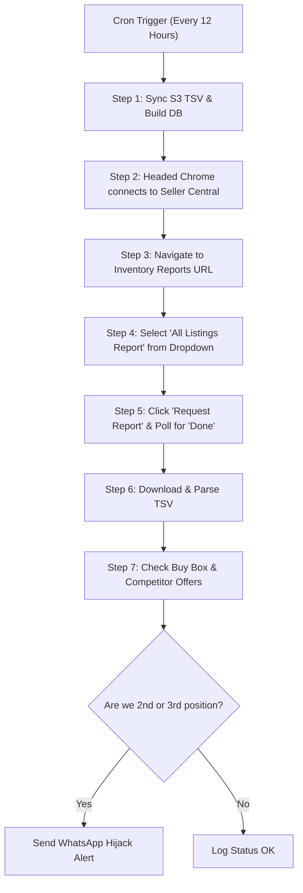

# Comprehensive Specification: Automated Alerts & Real-Time Business Insights Engine

> **Document Status:** Complete Architecture & Implementation Blueprint  
> **Target Execution:** Deployment & Development Scheduled for Tonight  
> **Scope:** Order Placer, Repricer, Inventory Scanner, WhatsApp & Telegram Notifications  

---

## Executive Summary

This specification outlines the comprehensive requirements for the next-generation **Alerts & Real-Time Business Insights Engine** for the dropshipping automation stack.

The system is designed in two complementary layers:
1. **Critical Placement & Operational Alerts**: Real-time event notifications sent with full product screenshots to WhatsApp (and Telegram) for immediate attention (Out-of-Stock, low-margin warnings < 8%, high-profit celebrations > 30%, and 12-hour automated listing hijack checks).
2. **Operational Anomaly & Insights Engine**: Historical delta analysis across orders to spot pricing shifts, supplier price increases, shipping template mismatches, supplier delivery risks, and inventory changes.

---

## Part 1: Core Mobile Placement Alerts (With Visual Screenshots)

All critical placement alerts must include the **Amazon SC page / Zoro product screenshot** alongside clear, monospaced metadata.

| # | Alert Trigger | Condition | Visual Media | Delivery Rule |
|---|---------------|-----------|--------------|---------------|
| **1** | **Listing Out of Stock (OOS)** | Zoro checkout reports OOS / 0 inventory | Amazon order detail screenshot + Zoro item photo | Immediate |
| **2** | **Low Profit Margin (< 8%)** | Calculated pre-tax profit margin `< 8.0%` | Amazon order page screenshot with price highlighted | Immediate (Flagged with ⚠️ warning) |
| **3** | **Mega Profit (> 30%)** | Calculated profit margin `> 30.0%` | Amazon order page screenshot | Immediate (Celebration format) |
| **—** | **Normal Orders (8% – 20%)** | Margin between `8.0%` and `20.0%` | *No alert required* | Suppressed to keep chat quiet |

### Alert Formatting Standards
- Every alert includes:
  - Amazon Order ID + Store Profile (HOANK / Hathoro)
  - ASIN + Product Title (clean, truncated to 60 chars)
  - Zoro Code (G-Number) + Quantity
  - Financial Breakdown: Payout, Cost, Shipping, Net Profit, Margin %
  - Pre-tax verification note

---

## Part 2: 12-Hour Background Repricer & Listing Hijack Scanner

A scheduled cron/background daemon running every **12 hours** that executes a complete supplier catalog sync, downloads the Amazon All Listings Report, and identifies listing hijacking.



### 1. Catalog Sync (`TSV Files/auto_download.py`)
- Sync latest Zoro catalog feed from AWS S3.
- Ingest into local SQLite catalog (`combined_reports.db`).

### 2. Automated "All Listings Report" Download
- **Target URL**: `https://sellercentral.amazon.com/listing/reports/ref=xx_invreport_dnav_xx`
- **Automation Flow**:
  1. Open Seller Central through authenticated Chrome debugging session.
  2. Locate the report dropdown: `select[name="reportType"]` or custom Seller Central dropdown selector.
  3. Select **"All Listings Report"** (`All Listings Report`).
  4. Click the **"Request Report"** button (`input[value="Request Report"]` or `button[name="requestReport"]`).
  5. Poll the table below (`Inventory Reports`) until the latest report status transitions from `In progress` to `Done` (typically 30–90 seconds).
  6. Click the yellow/grey **"Download"** button and save the TSV file into `Automations/data/reports/all_listings_report.tsv`.

### 3. Hijack & Buy Box Position Analysis
- For Private Label (PL) and priority listings:
  - Inspect the current listing offers on Amazon.
  - **Condition to alert**: If our seller account is NOT the Buy Box winner (#1) and is pushed to **2nd position** or **3rd position**.
  - **WhatsApp Alert**:
    ```text
    🚨 LISTING HIJACK ALERT: Position Dropped!
    Store    : Hathoro / HOANK
    ASIN     : B0XXXXXXXX
    Title    : [Product Title]
    Our Rank : #2 (Lost Buy Box)
    Winner   : [Competitor Store Name] ($XX.XX)
    Our Price: $XX.XX
    Action   : Check Repricer / Inventory
    ```

---

## Part 3: The 8 Operational Insights & Historical Anomaly Engine

The insights engine runs on every order during extraction and checkout, comparing current order attributes against the historical baseline recorded in `data/rajar_logs/order_log.txt` and `data/automations_unified.db`.

```
                    Historical Order Record (Database)
                                   ↕  [Compare]
                       Current Incoming Order
                                   ↓
     ┌─────────────────────────────────────────────────────────────┐
     │ 1. Item Price Changed (+ History)                           │
     │ 2. Zoro Base Price Changed (Excluding Shipping)             │
     │ 3. Zoro Code Changed (Alternative SKU Triggered)            │
     │ 4. Shipping Price Changed (Buyer Shipping Mismatch)         │
     │ 5. Delivery Window Mismatch (Zoro Arrive vs Amazon Deliver) │
     │ 6. Low Zoro Stock Warning                                   │
     │ 7. Clean Net Earnings / Unit Changed (Excl Ship & Tax)      │
     │ 8. Handling Time / Ship-By Window Changed                   │
     └─────────────────────────────────────────────────────────────┘
```

### Detailed Insight Rules

#### Insight 1: Amazon Item Price Changed (With Order History)
- **Problem**: When a listing price is raised or lowered, operators need immediate confirmation that sales are occurring at the new price, along with context on when the last order arrived at the old price.
- **Logic**:
  - Check `last_order` for the same ASIN in SQLite.
  - Compare `current_item_price` vs `last_order.item_price`.
  - If `abs(current_item_price - last_price) >= 0.50`:
- **Alert Example**:
  ```text
  📈 AMAZON PRICE CHANGE DETECTED
  ASIN       : B07CB25KWM
  SKU        : G4017277
  New Price  : $23.99 (Order: 114-xxxxxxx)
  Old Price  : $20.99 (Order: 113-xxxxxxx on Sep 02, 2026)
  Delta      : +$3.00 (+14.3%)
  ```

---

#### Insight 2: Zoro Base Price Changed (Direct Cost Fluctuation)
- **Problem**: Suppliers change base catalog prices unexpectedly, eroding profit margins.
- **Logic**:
  - Look up the previous Zoro purchase unit cost for this specific Zoro code (excluding flat shipping).
  - Compare `current_zoro_unit_cost` vs `previous_zoro_unit_cost`.
- **Alert Example**:
  ```text
  🏷️ ZORO BASE PRICE CHANGED
  Zoro Code  : G4017277
  Title      : Blue Def DEF002-2PK Diesel Exhaust Fluid
  Old Base   : $10.99
  New Base   : $11.99 (+$1.00 / +9.1%)
  Shipping   : $6.99 (Unchanged)
  Impact     : Margin decreased from 24.2% to 19.8%
  ```

---

#### Insight 3: Zoro Code Changed (Alternative SKU Used)
- **Problem**: When primary SKUs are OOS, orders fall back to mapped Alternative SKUs (`- ALT`). Operators must track which alternatives are actively absorbing volume.
- **Logic**:
  - Detected when `alt_used_any = True` or the purchased SKU differs from the primary mapped catalog SKU.
- **Alert Example**:
  ```text
  🔄 ALTERNATIVE SKU USED (Primary OOS)
  ASIN         : B0009J5NTK
  Primary Code : G314544396 (❌ Out of Stock on Zoro)
  Fulfilled By : G314544396-ALT (✅ Placed with Alternative)
  Order Cost   : $19.54 | Profit: +$3.80
  ```

---

#### Insight 4: Shipping Price Changed (Buyer Shipping Charge Mismatch)
- **Problem**: An ASIN configured with custom shipping (e.g. +$18.00 shipping charged to buyer) suddenly sells with $0.00 shipping because a shipping template reset on Seller Central.
- **Logic**:
  - Compare `shipping_amt` in Gmail earnings for current order vs historical average for this ASIN.
  - If previous orders had `shipping_amt > 0` and current order has `shipping_amt == 0`:
- **Alert Example**:
  ```text
  ⚠️ SHIPPING CHARGE MISMATCH!
  ASIN         : B0GKZSJTYL
  Expected Ship: $18.99 (Charged on previous 14 orders)
  Current Ship : $0.00 (FREE SHIPPING charged to buyer!)
  Impact       : Payout is $18.99 lower than expected!
  Action       : Verify Amazon Shipping Template for this SKU immediately!
  ```

---

#### Insight 5: Zoro vs Amazon Delivery Date Mismatch (Late Risk)
- **Problem**: Zoro's estimated delivery date exceeds Amazon's guaranteed Deliver-By date, causing a defect in Amazon's On-Time Delivery Rate (OTDR).
- **Logic**:
  - Extract Zoro's estimated arrival date at checkout (`zoro_deliver_date`).
  - Extract Amazon's `deliver_by_date` from order details.
  - If `zoro_deliver_date > amazon_deliver_by_date`:
- **Alert Example**:
  ```text
  ⏰ DELIVERY WINDOW MISMATCH (Late Risk)
  Amazon Order  : 112-2152492-4099412
  Deliver-By    : Wed, Sep 16, 2026 (Amazon Deadline)
  Zoro Est. Arr : Fri, Sep 18, 2026 (2 days LATE!)
  Carrier       : FedEx Ground
  Action        : Check expedited shipping or notify buyer.
  ```

---

#### Insight 6: Low Zoro Stock / Limited Availability Warning
- **Problem**: Supplier stock is nearly depleted, meaning subsequent orders will fail with OOS.
- **Logic**:
  - Zoro page or cart API returns `limitedShipping: True`, `salesStatus: 'Limited Quantity'`, or stock `< 5`.
- **Alert Example**:
  ```text
  📦 LOW ZORO STOCK WARNING
  Zoro Code  : G1607320
  Title      : 24 in x 16 in x 12 in Shipping Box, Kraft
  Zoro Status: Only 3 remaining in stock!
  Action     : Deactivate or reprice Amazon listing before stock runs out.
  ```

---

#### Insight 7: Clean Net Earnings / Unit Changed (Excluding Shipping & Tax)
- **Problem**: Comparing total payout can be deceptive if one order includes buyer shipping and another does not. Net earnings per unit must be isolated.
- **Logic**:
  $$\text{Clean Unit Earning} = \frac{\text{Earnings} - \text{Shipping Charge}}{\text{Quantity}}$$
  - Compare against historical average clean unit earnings for this ASIN.
  - Alert if clean unit earnings shift by more than 5%.
- **Alert Example**:
  ```text
  💰 CLEAN UNIT EARNINGS SHIFT
  ASIN        : B07J5TRDGM
  Current Unit: $29.19 / unit (Subtotal $58.38 / 2 units)
  Previous Avg: $35.44 / unit
  Delta       : -$6.25 / unit (-17.6%)
  ```

---

#### Insight 8: Amazon Handling Time Changed
- **Problem**: Amazon automatically alters handling times (e.g. from 3 days to 1 day), forcing orders into overdue status before Zoro ships.
- **Logic**:
  $$\text{Handling Days} = \text{Ship-By Date} - \text{Purchase Date}$$
  - Alert if `Handling Days` drops below expected default (e.g. was 3 days, now 1 day).
- **Alert Example**:
  ```text
  ⚡ HANDLING TIME REDUCED
  Amazon Order: 111-9349800-6125816
  Purchased   : Sun, Sep 13, 2026
  Ship-By     : Mon, Sep 14, 2026 (Handling: 1 Day)
  Expected    : 3 Days
  Risk        : Must ship today to avoid Late Shipment Rate defect!
  ```

---

## Part 4: Implementation Architecture & File Layout

### Files to Create / Extend Tonight

| File | Purpose |
|------|---------|
| `Automations/utils/insights_engine.py` | Historical lookup engine, anomaly detectors, and diff calculators. |
| `Automations/scripts/run_repricer_check.py` | 12-hour daemon: downloads S3 TSV, builds DB, downloads Amazon All Listings Report via Selenium, checks Buy Box 2nd/3rd rank. |
| `Automations/utils/whatsapp.py` | Media & text dispatch engine via local Baileys gateway (`http://127.0.0.1:3005`). |
| `Automations/engine/orders.py` | Integrate insight hooks during order processing & placement. |

---

## Part 5: Checklist for Tonight's Session

- [ ] Connect Selenium flow for `All Listings Report` download on port 9221/9222.
- [ ] Implement `Automations/utils/insights_engine.py` with the 8 historical insight rules.
- [ ] Add screenshot capture mechanism to `orders.py` for OOS, <8% margin, and >30% profit orders.
- [ ] Connect WhatsApp image delivery via Baileys API (`/send-media` endpoint).
- [ ] Schedule 12-hour automated background job in Launcher / cron.
- [ ] Test end-to-end on live orders.
