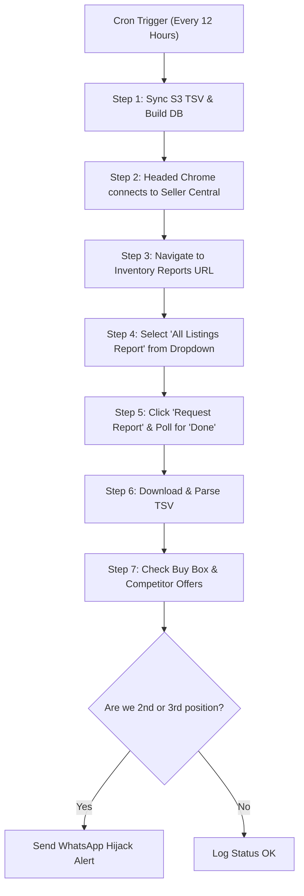

# Comprehensive Specification: Automated Alerts & Real-Time Business Insights Engine

> **Document Status:** Complete Architecture & Implementation Blueprint  
> **Target Execution:** Deployment & Development Scheduled for Tonight  
> **Scope:** Order Placer, Repricer, Inventory Scanner, WhatsApp & Telegram Notifications  

---

## How the alerts work now (9 Nov 2026, changes of 11 Nov 2026) — read this first

This section overrides anything below it. The original plan further down is kept for history.

Two engines send alerts:

* `dashboard/insights.py` + `scripts/send_insights_alerts.py`: hourly, one Insights group per store
  (`auto_sync_10min.py`, HOANK / Hathoro / Wrenchly). Sent items are recorded in
  `whatsapp_dispatched_insights`, so each goes out once. The dashboard's Analytics → Changes page
  reads the same `compute()`.
* `utils/insights_engine.py`: at placement, Orders group. Only `DELIVERY_MISMATCH_LATE` reaches WhatsApp.

Rules:

| Alert | Rule |
|---|---|
| Zoro price up / down | The Unit Price on Zoro's order e-mail differs from that code's previous e-mail, to the cent, either direction. One alert per change, to the store whose order showed it first. The alert line ends at the old price's date: "… New price first on WB… (Wed, Nov 11); old price last on WB… (Wed, Nov 11)". The listings on the code are kept on the item (`listings`), not in the text (owner, 11 Nov 2026). |
| Earnings up / down | Per (store, ASIN): unit earnings by day against the previous day with orders, over 60 days of history. Combined-ASIN orders are left out. closing's quantity wins over the placer's. |
| Zoro late vs Amazon | Zoro's date is 2+ **business** days after Amazon's, on an order placed within 1 business day. One per listing per **day** (owner, 11 Nov 2026: "no make this daily"; it was one per week), showing the day's latest late order; "(N orders that day)" counts that day's late orders. Key `{store}:{asin}:late_vs_promise:{order day}`. |
| Handling review | Weekly summary. Listings with 5+ orders in 30 days, usually 2+ business days to ship-by, and Zoro not tight against Amazon's date. |
| Out of stock — **placer**, at the moment an order is marked OOS (`utils.telegram.notify_oos`) | One per **Zoro code per store per hour** (owner, 12 Nov 2026: 28 orders of one Wrenchly barrel sent 28 alerts). Every order is still marked OOS; the alert says the item's other orders are marked quietly for the hour. `bot_config.json → oos_alert_every_min` (60; 0 = one per order), state in `data/oos_alert_state.json`, shared by the store's profiles. |
| Out of stock | One per listing per **6-hour block** of Pakistan time — 00–06, 06–12, 12–18, 18–24 (owner, 11 Nov 2026: "after every 6 hours"; it was one per day). The block is that of the out-of-stock event by its real time: `bot_decisions.ts` (the priority check, this Mac's clock) or closing's purchase date (US/Pacific, converted). A new event in a later block alerts again; no new event, no repeat. "on N orders" counts the orders of that block (the priority check names none). The hourly sender sends only a listing's latest block, and never two out-of-stock alerts for one listing within 6 hours (`OOS_SPACING_HOURS`: a sweep across 00/06/12/18 would otherwise give two an hour apart; the skipped block keeps its key and goes out later if the listing is still out). Key `{store}:{asin}:oos:{YYYY-MM-DD}T{00/06/12/18}`. |
| Alternative SKU used | One per ASIN per day. |
| Low margin | Placed under 8%: one per ASIN per day, showing the lowest. Rejected orders stay per order. |
| Zoro shipping rule | List price × qty against the $50 line, and only when Zoro charged more than its rule. |
| Buyer shipping | Buyer paid on a listing that ships free (70%+ of its last 10 orders), or a paid listing went free. The paid one ends at "(this listing usually ships free)" — "make sure it goes out fast" was removed (owner, 11 Nov 2026). |
| Buyer ZIP mismatch | Amazon's ship ZIP and the ZIP on Zoro's order differ in the first 5 digits. The alert line names the order (owner, 11 Nov 2026: "Add order number"), e.g. (made up) "Ship ZIP 75201 on Order 113-0000000-0000000 does not match Zoro's ZIP 75202". |
| Refunded, Undelivered, Shipped late, WB unmatched | One daily summary per store, from 12:00 local (`ZUHRA_SUMMARY_HOUR`). |

Every hourly alert arrives in one frame (`send_insights_alerts._frame`): the header, then
"• Title: *…*" — the **first five real words** of the listing title, without the comma, dash or
connector the cut stops on (owner, 11 Nov 2026: "Make the title short in this alert like max 5
words"; fix 4 below) — "• SKU", "• ASIN", "• Order", "• Date" (the Amazon order day; with the time
for Out of stock only, fix 6), a blank line, "• Alert: …". Title and SKU come from the item, else
the listing's closing / placer rows, else the order's placer row, else Amazon's order report
(`amazon_report_orders`) or the listing guard's `listing_oos`, the alert's own store first (fix 5)
(an ASIN the priority check found out of
stock that never had a placed order). Checked on 11 Nov 2026 over 14 days of real data, all three
stores: every Buyer shipping, Zoro price, Alternative SKU, Out of stock and Zoro late frame had
Title, SKU and ASIN; every ZIP mismatch (60 days) had its order. Out of stock frames have no Order
line: the priority check that finds them names no order.

The keys of Out of stock and Zoro late changed on 11 Nov 2026. `_covered_by_old_key()` in the sender
keeps what the old keys already announced from going out again (it would have been 26 HOANK and
13 Hathoro items that day), without writing anything; no `--baseline` was run.

Follow-up fixes, same day (11 Nov 2026):

1. **Zoro late, old-key guard by time.** The guard compared the item's day (Amazon's, US/Pacific)
   with the date the old weekly alert was recorded (Pakistan clock), so a new day's alert was
   hidden: a Hathoro listing's order of 10 Nov (13:54 here) counted as covered by the weekly alert
   of 10 Nov 00:06, which was about 9 Nov. The Zoro-late item now carries `first_seen` and
   `last_seen` — the day's first and latest late order, Pakistan clock — and is covered only when
   `first_seen` is at or before the old alert's recorded time. The first, not the latest: the new
   key is one per listing per day, so later orders of a day already announced would not alert again
   either (a HOANK listing: first late order 04:19, weekly alert 04:32, two more after). Measured on
   the live data: of the 39 items the old keys covered, that one Hathoro item now goes out, 38 stay held.
2. **The guard ends.** `OLD_KEYS_UNTIL = 14 Nov 2026`: after that date `_old_key_times()` returns
   nothing without reading the table and `_covered_by_old_key()` is always False — the hourly run
   looks back 2 days, so no item it sees can carry an old key. Both can be deleted after that date.
   (A manual `--days 7` run after it could re-announce items of 9–11 Nov.)
3. **Order times.** `insights._order_time()`: closing's purchase_date (US/Pacific, with a time) →
   Pakistan time; a placer row's purchase_date is the day alone, so its `placed_at` is used —
   which holds two clocks: `2026-11-11T00:20:13` is this Mac's, `2026-11-11 08:54:31` is UTC (the
   column's DEFAULT CURRENT_TIMESTAMP on rows inserted without placed_at), read by `_placed_time()`.
   The Zoro-late "we placed it late" test now puts both days on Amazon's US/Pacific clock
   (`_pacific_day`); comparing the Pacific purchase day with placed_at's own date dropped ~12 % of
   late orders (26 of 215 since 28 Oct). Out of stock uses it when a closing row has no time;
   Zoro late picks the day's latest late order by it (it compared raw text, and placer rows all
   read `2026-11-10`). No key changed: every key of every category was the same before and after
   over 2, 14 and 60 days, all three stores.
4. **Title.** `_short_title()` counts only real words toward the five (a letter or digit; a lone
   `x`, `-`, `|`, `&` does not count; the `1/2` of `1 1/2` belongs to its number), and the cut never
   ends on a connector (for, with, and, of, in, x, to, by, the, a, or, on, &; the `in` of `48 in` is a
   unit and stays): "4 Gallons -Muriatic Acid", "Eagle 55 Gallon Drum", "Hex Cap Screw, 5/8-11 x 1 1/2",
   "28 x 28 x 20" Corrugated Boxes". A cut that is only sizes goes on to the first product word,
   up to eight real words (none of 1,832 real titles needed it; real-word counting already reaches
   the product word in "28 x 28 x 20" Corrugated Boxes").
5. **Title / SKU lookup by store.** `_lookup_listing()` asks Amazon's report (`account`) and
   `listing_oos` (`store`) for the alert's own store first — 'HOANK', 'Hathoro', 'Wrenchly' in both
   tables; 61 ASINs appear under two stores with different SKUs — and any store only when that finds
   nothing.
6. **Date with the time — Out of stock only.** An out-of-stock block shows "• Date: Wed, Nov 11,
   1:54 PM PKT" (the block's latest event), because one listing can alert up to four times a day.
   Every other alert, Zoro late included, keeps the Amazon order day alone: a Zoro-late item's
   latest time is often our placement on the next Pakistan day and would not match Seller Central.
   Keys unchanged.

Measured, not changed (11 Nov 2026): the 6-hour Out of stock repeat almost never fires, because its
only live source is the priority check (`bot_decisions`, no order ids): 4–10 Nov, HOANK 90 blocks on
88 listing-days, Hathoro 26 on 23. Amazon's own report has the real out-of-stock orders
(`amazon_report_orders.merchant_order_id = 'OOS'`). Were they a second source, same 7 days, Pakistan
days: HOANK 7.6 listings a day with OOS orders, 11.1 blocks a day from them (25 repeats a week),
12.9 → 23.1 alerts a day with both sources; Hathoro 2.9 listings, 3.0 blocks, 3.7 → 6.7 alerts a
day; Wrenchly none. Of those listings (HOANK 26, Hathoro 16) the listing guard's `listing_oos` held
4 and 1 — but it only started on 10 Nov. The priority check never flagged HOANK 13 of 26 and
Hathoro 11 of 16. Most blocks, 4–10 Nov: HOANK B0FJC6VX29 11, B01LXTQFRD 7, B00TY4AMZQ 7,
B0GV9GHGQD 6, B0GSSK9ZM8 5; Hathoro B07K51BK2S 3, B000BPLNXC 2, B0095GI1VA 2, B0HGD8DNTT 2. The
owner decides.

Two more senders, added 10 Nov 2026, each with its own once-only memory. Both message the Insights
group themselves, at once, and write one row per event to `listing_events`, which
`insights.compute()` turns into six Insights categories (`listing_off_sale`, `listing_back_on_sale`,
`own_brand_other_seller`, `own_brand_rating`, `own_brand_reviews`, `own_brand_category`). The
hourly sender skips those categories (`utils.listing_events.SENT_AT_SOURCE`) — do not add them to
its headers, or each arrives twice.

| Alert | Where | Rule |
|---|---|---|
| Listing still selling, Zoro out; listing back when Zoro restocks | `engine/listing_guard.py` → **Insights group only**, never the Orders group (owner, 11 Nov 2026: first for handling time, then for quantity 0 as well) | The placer found the main Zoro code and every alternative out of stock (for one unit of the listing; an alternative that did not answer does not count as out). The placer then makes the change on Seller Central itself (`engine/offer_edit.py`: DS quantity 0; PL handling time 7 days, never 0) and sends one message per listing saying PL or DS — from the brand on the product page — and what was done, or what to do by hand if it could not. If orders keep coming the listing is looked at again on Seller Central: after 2 h when its quantity was set to 0 (the change may not have stuck), after 24 h when its handling time was raised (an own-brand listing stays on sale, so orders are expected) or when it could not be changed. A listing that still holds what the guard set is **not announced again** — only a new change or a failure is (11 Nov 2026: two own-brand listings had been announced again every 2–3 hours, 6 repeats in one night, each to both groups). Every 30 min the placer asks Zoro again; when the main code or an alternative is buyable for 3 units of the listing it puts back what it changed (and only that), and says so. The Zoro code goes on Restock Watch. Table `listing_oos`. **Own-brand listings (13 Nov 2026):** HOANK / Hathoro / Wrenchly brand; a foreign brand on an own-looking SKU → nothing changed, "Please check it"; a PL listing at quantity 0 → left alone ("Its Amazon quantity is 0 … I left it as it is"); a hand-set handling time (anything but empty / the store default) → left alone; put back only after Zoro has 10 units for an hour; out again within 24 h of a put-back → the restock message gives the value to set by hand. An item with Zoro "Extended lead time" is not counted as back (PL and DS). |
| Own-brand listings: what changed | `utils/listing_watch.py` → Insights group | During the 12-hourly repricer scrape, for listings whose brand is HOANK / Hathoro: a seller who is none of our stores and was not there last time, the star rating moved, the number of ratings changed, the category changed. One message per store and run. The first look at a listing only records it. A value the page did not show keeps the remembered one. `data/pl_watch_state.json`. |

No code boxes in WhatsApp (owner, 11 Nov 2026): `utils.whatsapp._plain()` drops every backtick from
a message or caption as it leaves for the gateway, so an order id, SKU or ASIN shows as plain text,
not a grey monospace box. `*bold*` and `_italic_` stay. Senders may keep their backticks; Telegram
(HTML) is not touched.

Things that bit us, do not reintroduce:

* Compare dates with `_d()` / `_day()`, never as text: order tables hold ISO, `Sat, Nov 7, 2026`,
  `Wed, May 20, 2026, 1:20 PM PDT`, and `date| ZoroDeliverBy:…`. As text, `Sat, Nov 7` sorts after
  `2026-11-09`, so old orders passed the today-only check and were compared in the wrong order.
* Never rebuild a Zoro price from order totals: coupons, promos and shipping all look like price changes.
* Business days skip Sat/Sun only; US holidays are not modelled.
* Low Zoro stock was removed: Zoro's availability call returned no quantity on any of 26,463 orders.
* After changing how alerts are keyed, old events must not be announced again: either a guard like
  `_covered_by_old_key()` (11 Nov 2026), or `scripts/send_insights_alerts.py --baseline --days 30`
  — which also marks the items of the daily summary categories as reported, so they never reach
  a summary.

---

## Executive Summary

This specification outlines the comprehensive requirements for the next-generation **Alerts & Real-Time Business Insights Engine** for the dropshipping automation stack.

The system is designed in two complementary layers:
1. **Critical Placement & Operational Alerts**: Real-time event notifications sent with full product screenshots to WhatsApp (and Telegram) for immediate attention (Out-of-Stock, low-margin warnings < 8%, high-profit celebrations > 30%, and 12-hour automated listing hijack checks).
2. **Operational Anomaly & Insights Engine**: Historical delta analysis across orders to spot pricing shifts, supplier price increases, shipping template mismatches, supplier delivery risks, and inventory changes.

---

## Part 1: Core Mobile Placement Alerts (With Visual Screenshots)

All critical placement alerts must include the **Amazon SC page / Zoro product screenshot** alongside clear, monospaced metadata.

| # | Alert Trigger | Condition | Visual Media | Delivery Rule |
|---|---------------|-----------|--------------|---------------|
| **1** | **Listing Out of Stock (OOS)** | Zoro checkout reports OOS / 0 inventory | Amazon order detail screenshot + Zoro item photo | Immediate |
| **2** | **Low Profit Margin (< 8%)** | Calculated pre-tax profit margin `< 8.0%` | Amazon order page screenshot with price highlighted | Immediate (Flagged with ⚠️ warning) |
| **3** | **Mega Profit (> 30%)** | Calculated profit margin `> 30.0%` | Amazon order page screenshot | Immediate (Celebration format) |
| **—** | **Normal Orders (8% – 20%)** | Margin between `8.0%` and `20.0%` | *No alert required* | Suppressed to keep chat quiet |

### Alert Formatting Standards
- Every alert includes:
  - Amazon Order ID + Store Profile (HOANK / Hathoro)
  - ASIN + Product Title (clean, truncated to 60 chars)
  - Zoro Code (G-Number) + Quantity
  - Financial Breakdown: Payout, Cost, Shipping, Net Profit, Margin %
  - Pre-tax verification note

---

## Part 2: 12-Hour Background Repricer & Listing Hijack Scanner

A scheduled cron/background daemon running every **12 hours** that executes a complete supplier catalog sync, downloads the Amazon All Listings Report, and identifies listing hijacking.



### 1. Catalog Sync (`TSV Files/auto_download.py`)
- Sync latest Zoro catalog feed from AWS S3.
- Ingest into local SQLite catalog (`combined_reports.db`).

### 2. Automated "All Listings Report" Download
- **Target URL**: `https://sellercentral.amazon.com/listing/reports/ref=xx_invreport_dnav_xx`
- **Automation Flow**:
  1. Open Seller Central through authenticated Chrome debugging session.
  2. Locate the report dropdown: `select[name="reportType"]` or custom Seller Central dropdown selector.
  3. Select **"All Listings Report"** (`All Listings Report`).
  4. Click the **"Request Report"** button (`input[value="Request Report"]` or `button[name="requestReport"]`).
  5. Poll the table below (`Inventory Reports`) until the latest report status transitions from `In progress` to `Done` (typically 30–90 seconds).
  6. Click the yellow/grey **"Download"** button and save the TSV file into `Automations/data/reports/all_listings_report.tsv`.

### 3. Hijack & Buy Box Position Analysis
- For Private Label (PL) and priority listings:
  - Inspect the current listing offers on Amazon.
  - **Condition to alert**: If our seller account is NOT the Buy Box winner (#1) and is pushed to **2nd position** or **3rd position**.
  - **WhatsApp Alert**:
    ```text
    🚨 LISTING HIJACK ALERT: Position Dropped!
    Store    : Hathoro / HOANK
    ASIN     : B0XXXXXXXX
    Title    : [Product Title]
    Our Rank : #2 (Lost Buy Box)
    Winner   : [Competitor Store Name] ($XX.XX)
    Our Price: $XX.XX
    Action   : Check Repricer / Inventory
    ```

---

## Part 3: The 8 Operational Insights & Historical Anomaly Engine

The insights engine runs on every order during extraction and checkout, comparing current order attributes against the historical baseline recorded in `data/rajar_logs/order_log.txt` and `data/automations_unified.db`.

```
                    Historical Order Record (Database)
                                   ↕  [Compare]
                       Current Incoming Order
                                   ↓
     ┌─────────────────────────────────────────────────────────────┐
     │ 1. Item Price Changed (+ History)                           │
     │ 2. Zoro Base Price Changed (Excluding Shipping)             │
     │ 3. Zoro Code Changed (Alternative SKU Triggered)            │
     │ 4. Shipping Price Changed (Buyer Shipping Mismatch)         │
     │ 5. Delivery Window Mismatch (Zoro Arrive vs Amazon Deliver) │
     │ 6. Low Zoro Stock Warning                                   │
     │ 7. Clean Net Earnings / Unit Changed (Excl Ship & Tax)      │
     │ 8. Handling Time / Ship-By Window Changed                   │
     └─────────────────────────────────────────────────────────────┘
```

### Detailed Insight Rules

#### Insight 1: Amazon Item Price Changed (With Order History)
- **Problem**: When a listing price is raised or lowered, operators need immediate confirmation that sales are occurring at the new price, along with context on when the last order arrived at the old price.
- **Logic**:
  - Check `last_order` for the same ASIN in SQLite.
  - Compare `current_item_price` vs `last_order.item_price`.
  - If `abs(current_item_price - last_price) >= 0.50`:
- **Alert Example**:
  ```text
  📈 AMAZON PRICE CHANGE DETECTED
  ASIN       : B07CB25KWM
  SKU        : G4017277
  New Price  : $23.99 (Order: 114-xxxxxxx)
  Old Price  : $20.99 (Order: 113-xxxxxxx on Sep 02, 2026)
  Delta      : +$3.00 (+14.3%)
  ```

---

#### Insight 2: Zoro Base Price Changed (Direct Cost Fluctuation)
- **Problem**: Suppliers change base catalog prices unexpectedly, eroding profit margins.
- **Logic**:
  - Look up the previous Zoro purchase unit cost for this specific Zoro code (excluding flat shipping).
  - Compare `current_zoro_unit_cost` vs `previous_zoro_unit_cost`.
- **Alert Example**:
  ```text
  🏷️ ZORO BASE PRICE CHANGED
  Zoro Code  : G4017277
  Title      : Blue Def DEF002-2PK Diesel Exhaust Fluid
  Old Base   : $10.99
  New Base   : $11.99 (+$1.00 / +9.1%)
  Shipping   : $6.99 (Unchanged)
  Impact     : Margin decreased from 24.2% to 19.8%
  ```

---

#### Insight 3: Zoro Code Changed (Alternative SKU Used)
- **Problem**: When primary SKUs are OOS, orders fall back to mapped Alternative SKUs (`- ALT`). Operators must track which alternatives are actively absorbing volume.
- **Logic**:
  - Detected when `alt_used_any = True` or the purchased SKU differs from the primary mapped catalog SKU.
- **Alert Example**:
  ```text
  🔄 ALTERNATIVE SKU USED (Primary OOS)
  ASIN         : B0009J5NTK
  Primary Code : G314544396 (❌ Out of Stock on Zoro)
  Fulfilled By : G314544396-ALT (✅ Placed with Alternative)
  Order Cost   : $19.54 | Profit: +$3.80
  ```

---

#### Insight 4: Shipping Price Changed (Buyer Shipping Charge Mismatch)
- **Problem**: An ASIN configured with custom shipping (e.g. +$18.00 shipping charged to buyer) suddenly sells with $0.00 shipping because a shipping template reset on Seller Central.
- **Logic**:
  - Compare `shipping_amt` in Gmail earnings for current order vs historical average for this ASIN.
  - If previous orders had `shipping_amt > 0` and current order has `shipping_amt == 0`:
- **Alert Example**:
  ```text
  ⚠️ SHIPPING CHARGE MISMATCH!
  ASIN         : B0GKZSJTYL
  Expected Ship: $18.99 (Charged on previous 14 orders)
  Current Ship : $0.00 (FREE SHIPPING charged to buyer!)
  Impact       : Payout is $18.99 lower than expected!
  Action       : Verify Amazon Shipping Template for this SKU immediately!
  ```

---

#### Insight 5: Zoro vs Amazon Delivery Date Mismatch (Late Risk)
- **Problem**: Zoro's estimated delivery date exceeds Amazon's guaranteed Deliver-By date, causing a defect in Amazon's On-Time Delivery Rate (OTDR).
- **Logic**:
  - Extract Zoro's estimated arrival date at checkout (`zoro_deliver_date`).
  - Extract Amazon's `deliver_by_date` from order details.
  - If `zoro_deliver_date > amazon_deliver_by_date`:
- **Alert Example**:
  ```text
  ⏰ DELIVERY WINDOW MISMATCH (Late Risk)
  Amazon Order  : 112-2152492-4099412
  Deliver-By    : Wed, Sep 16, 2026 (Amazon Deadline)
  Zoro Est. Arr : Fri, Sep 18, 2026 (2 days LATE!)
  Carrier       : FedEx Ground
  Action        : Check expedited shipping or notify buyer.
  ```

---

#### Insight 6: Low Zoro Stock / Limited Availability Warning
- **Problem**: Supplier stock is nearly depleted, meaning subsequent orders will fail with OOS.
- **Logic**:
  - Zoro page or cart API returns `limitedShipping: True`, `salesStatus: 'Limited Quantity'`, or stock `< 5`.
- **Alert Example**:
  ```text
  📦 LOW ZORO STOCK WARNING
  Zoro Code  : G1607320
  Title      : 24 in x 16 in x 12 in Shipping Box, Kraft
  Zoro Status: Only 3 remaining in stock!
  Action     : Deactivate or reprice Amazon listing before stock runs out.
  ```

---

#### Insight 7: Clean Net Earnings / Unit Changed (Excluding Shipping & Tax)
- **Problem**: Comparing total payout can be deceptive if one order includes buyer shipping and another does not. Net earnings per unit must be isolated.
- **Logic**:
  $$\text{Clean Unit Earning} = \frac{\text{Earnings} - \text{Shipping Charge}}{\text{Quantity}}$$
  - Compare against historical average clean unit earnings for this ASIN.
  - Alert if clean unit earnings shift by more than 5%.
- **Alert Example**:
  ```text
  💰 CLEAN UNIT EARNINGS SHIFT
  ASIN        : B07J5TRDGM
  Current Unit: $29.19 / unit (Subtotal $58.38 / 2 units)
  Previous Avg: $35.44 / unit
  Delta       : -$6.25 / unit (-17.6%)
  ```

---

#### Insight 8: Amazon Handling Time Changed
- **Problem**: Amazon automatically alters handling times (e.g. from 3 days to 1 day), forcing orders into overdue status before Zoro ships.
- **Logic**:
  $$\text{Handling Days} = \text{Ship-By Date} - \text{Purchase Date}$$
  - Alert if `Handling Days` drops below expected default (e.g. was 3 days, now 1 day).
- **Alert Example**:
  ```text
  ⚡ HANDLING TIME REDUCED
  Amazon Order: 111-9349800-6125816
  Purchased   : Sun, Sep 13, 2026
  Ship-By     : Mon, Sep 14, 2026 (Handling: 1 Day)
  Expected    : 3 Days
  Risk        : Must ship today to avoid Late Shipment Rate defect!
  ```

---

## Part 4: Implementation Architecture & File Layout

### Files to Create / Extend Tonight

| File | Purpose |
|------|---------|
| `Automations/utils/insights_engine.py` | Historical lookup engine, anomaly detectors, and diff calculators. |
| `Automations/scripts/run_repricer_check.py` | 12-hour daemon: downloads S3 TSV, builds DB, downloads Amazon All Listings Report via Selenium, checks Buy Box 2nd/3rd rank. |
| `Automations/utils/whatsapp.py` | Media & text dispatch engine via local Baileys gateway (`http://127.0.0.1:3005`). |
| `Automations/engine/orders.py` | Integrate insight hooks during order processing & placement. |

---

## Part 5: Checklist for Tonight's Session

- [ ] Connect Selenium flow for `All Listings Report` download on port 9221/9222.
- [ ] Implement `Automations/utils/insights_engine.py` with the 8 historical insight rules.
- [ ] Add screenshot capture mechanism to `orders.py` for OOS, <8% margin, and >30% profit orders.
- [ ] Connect WhatsApp image delivery via Baileys API (`/send-media` endpoint).
- [ ] Schedule 12-hour automated background job in Launcher / cron.
- [ ] Test end-to-end on live orders.
