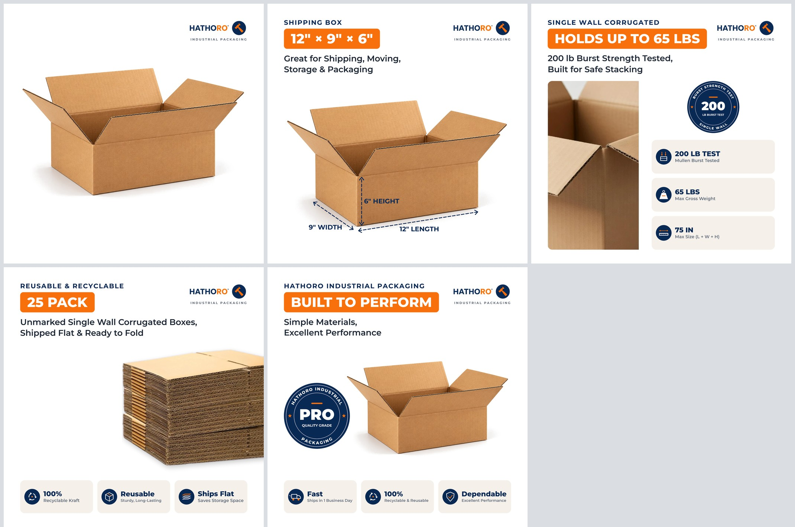

# Hathoro Shipping Boxes: Catalog Automation

Turns Zoro Select shipping box rows into ready-to-import Shopify listings for hathoro.com:

1. **Extract**: reads `combined_reports.db` (read-only) with the plan's filters.
2. **Parse**: box size, wall type, strength rating (ECT or burst test) and pack size from the descriptions.
3. **Price**: 10% partner discount, $5.99 freight under $50, 10% net margin, prices end in .99.
4. **Images**: 5 branded 1500×1500 JPGs per listing, all in one theme (white, Montserrat, Hathoro navy/orange).
5. **Shopify CSV**: current Shopify product template, one product per box, 5 image rows,
   `Collection` = Shipping Boxes plus the category its automated rule matches.
6. **Validate**: every run ends with a report (data, pricing, image files, Shopify CSV rules)
   and exits with an error code if anything would break the import.



## The 5 images

| # | image | photo | changes per listing |
|---|---|---|---|
| 1 | Main | the product's **own Zoro photo**, trimmed and centred, Hathoro logo top-right | photo |
| 2 | Dimensions | fixed Hathoro open-box photo with dimension arrows | size badge, box type, the 3 labels |
| 3 | Corrugated | fixed close-up photo of the corrugated edges | ECT or burst rating, max weight, size limit, wall type |
| 4 | Pack | fixed photo of a flat-packed stack | pack count, wall type |
| 5 | Made in USA | fixed Hathoro open-box photo + USA seal | Made in USA or not |

Images 2 to 5 always use the same real photos. Only their text changes, so every listing
looks the same. The dimension arrows sit on anchor points measured on the box photo, so any
size can be written on them.

Automatic fallbacks keep the images truthful:

- **ECT vs burst:** a box rated "200#" (Mullen burst test) is described as "200 lb burst test",
  never as an ECT value; only boxes rated in ECT get ECT wording.
- **No ECT or burst rating in the data:** image 3 uses `corrugated_generic` (no weight or size claims).
- **Country of origin not USA, or unknown:** image 5 uses `origin_not_usa` (no Made in USA claim).
- **No supplier photo:** image 1 uses the Hathoro box photo, and the row is listed in `exceptions.csv`.

## Setup

```bash
pip install -r requirements.txt
```

## Run

```bash
# 1 test product from test_data/ (no database needed)
python generate_shipping_boxes_catalog.py --fixture test_data/G0507745.json \
    --out-dir output/test_G0507745 --csv-name G0507745_shopify_import.csv --status draft

# the same product from the real Zoro database (on the Mac)
python generate_shipping_boxes_catalog.py --sku G0507745 \
    --out-dir output/test_G0507745 --csv-name G0507745_shopify_import.csv --status draft

# the whole catalog, resume-safe
python generate_shipping_boxes_catalog.py --workers 4 --skip-existing

# tests
python tests/test_pipeline.py
python tests/test_tunnel.py
```

Useful options: `--image-base-url URL` (where the images are hosted, see below),
`--status draft` (safe test imports), `--check-urls` (validation downloads every image URL),
`--only main,dimensions`, `--no-images`.

Output of a run (`output/` is not committed to git):

```
<out-dir>/
  G0507745_shopify_import.csv            Shopify import file
  validation_report.txt                  ERROR / WARNING / OK for every check
  exceptions.csv                         rows skipped or warned, and why
  upload_to_shopify_files/               every distinct image once, ready to upload
  images/<handle>/
    1_Hathoro_12x9x6_G0507745_Main.jpg
    2_Hathoro_12x9x6_SingleWall_Dimensions.jpg
    3_Hathoro_SingleWall_200lb.jpg
    4_Hathoro_SingleWall_25Pack.jpg
    5_Hathoro_Quality.jpg                (5_Hathoro_Made_In_USA.jpg when the origin is USA)
    listing.json                         parsed specs + price breakdown
```

One listing takes about 4 seconds. Images 2 to 5 are reused when their text is the same, and
their file names only repeat when the picture is identical, so all images can share one folder.

## Importing into Shopify (with images, via a Cloudflare tunnel)

Shopify only imports images from public https links, and it copies them to its own CDN
during the import. `import_via_tunnel.py` serves the images from your Mac through a
temporary Cloudflare quick tunnel for exactly that window:

```bash
brew install cloudflared          # once

# test product
python import_via_tunnel.py --sku G0507745 --out-dir output/test_G0507745 \
    --csv-name G0507745_shopify_import.csv --status draft

# whole catalog
python import_via_tunnel.py --workers 4 --skip-existing
```

What happens:

1. A local server shares **only** the run's `upload_to_shopify_files/` images on
   `http://localhost:8080` (read-only, no folder listing).
2. `cloudflared tunnel --url http://localhost:8080` creates a `https://….trycloudflare.com`
   link; the script waits until the link really answers.
3. The pipeline runs with that link as `--image-base-url` and `--check-urls`, so every image
   link in the CSV is downloaded through the tunnel before you import. If anything fails,
   it stops and tells you not to import.
4. It prints **NOW IMPORT IN SHOPIFY**: go to **Products → Import**, choose the CSV it names
   (tick *Overwrite products with matching handles* when re-importing). Keep the window open.
5. It counts Shopify's downloads ("Shopify has downloaded 5/5 images"), and closes the tunnel
   by itself 60 s after the last one (`--grace`). Ctrl+C stops it at any time.

The link changes on every run, so always import the CSV from the current run while it is
open. Options: `--port 8081` if 8080 is busy, `--keep-open`, `--tunnel-url` for a tunnel or
host you already run. Any other option goes to `generate_shipping_boxes_catalog.py`.

Without the tunnel, `generate_shipping_boxes_catalog.py` writes a valid CSV with no images
(or use `--image-base-url` with any other public host, e.g. Shopify Content → Files).

**After the import:** the product shows in **Collections → Shipping Boxes**. The CSV sets the
category `Office Supplies > Shipping Supplies > Moving & Shipping Boxes` (ID `os-14-1`), which
the collection's rule matches, plus the `Collection` column. A `draft` product stays hidden
from the storefront until you set it to active.

## Supplier photos (image 1)

For each row, the script looks for the photo in this order:

1. `output/zoro_photos/<zoro_no>.jpg|png|webp`, a file you dropped in by hand or one downloaded earlier
2. `image_path` in the row (used by the sample)
3. a download of `zoro_image_name`, using `zoro_images.url_template` in `catalog_settings.json`

The download sends browser headers and a zoro.com referer, and retries with backoff.
**Check `url_template`**: copy the exact image URL pattern from your working 108-drum script.

## Changing text

**Every word on every image is in `content.json`.** Placeholders are filled in per listing:

| placeholder | example |
|---|---|
| `{L}` `{W}` `{H}` | `22`, `12-1/2` |
| `{pack}` | `25` |
| `{wall}` / `{WALL}` | `Single Wall` / `SINGLE WALL` |
| `{rating}` `{rating_claim}` | `32 ECT` / `200# Test`, `200 lb Burst Strength Tested` |
| `{max_lbs}` `{size_limit}` | `65`, `75` (box maker's certificate limits for the rating) |
| `{box_type}` | `FLAT SHIPPING BOX`, `CUBE SHIPPING BOX`, `LONG SHIPPING BOX`, `HEAVY-DUTY ...` |
| `{spec_line}` | `Single Wall Corrugated · 200# Test` |
| `{sku}` `{wall_slug}` | `G0507745`, `SingleWall` |

Use `\n` for a line break. File names are in `content.json` too (`"file"`). Set
`main.show_info` to `true` to add the size and a pack pill under the main photo.

One-off changes without editing the file:

```bash
python make_images.py --size 22x18x8 --pack 25 --ect 32 --made-in-usa --photo my_photo.jpg
python make_images.py --size 22x18x8 --pack 25 --set "pack.badge={pack} BOXES" \
                      --set "dimensions.subline=Perfect for Moving\nand Storage"
```

From Python:

```python
from hathoro import make_images

make_images("22x18x8", pack=25, ect=32, made_in_usa=True, photo="my_photo.jpg",
            text={"pack": {"badge": "{pack} BOXES"},
                  "dimensions": {"subline": "Perfect for Moving\nand Storage"}},
            theme={"colors": {"orange": "#E85D04"}})
```

Shopify title, handle, SKU, tags, SEO text and image alt text are templates in
`catalog_settings.json`. The product description is `templates/body.html`.

## Changing the look (`theme.json`)

| key | controls |
|---|---|
| `colors` | brand navy/orange, text grays, tile background |
| `fonts` | Montserrat weights (bundled in `assets/fonts`, free OFL licence) |
| `text` | size, weight, color and letter spacing of each text style |
| `layout` | margins, logo size, tile size, gaps (px on a 1500 px canvas) |
| `canvas` | output size; everything scales (e.g. `1024` as in the plan, or `2048` for Shopify zoom) |
| `logo`, `logo_subtitle` | logo file (replace `assets/logo.png` with a high-res original) and the line under it |
| `photos` | the fixed template photos and the box anchor points |

### Replacing a template photo

The current template photos come from the images you shared, which are about 1000 px, so
they are a little soft at 1500 px. To use better ones:

1. Put the new photos in `assets/photos/source/` and adjust the crops in `tools/prepare_photos.py`.
2. Run `python tools/prepare_photos.py` to write `assets/photos/open_box.png`, `flat_stack.png` and `closeup.jpg`.
3. For a new open-box photo, update `photos.open_box.anchors` in `theme.json` (pixel
   positions of the box corners), then run `python tools/check_anchors.py` and look at
   `output/anchors_open_box.png`. The lines must sit on the box edges.

## Pricing (`catalog_settings.json` → `pricing`)

```
base     = sales_price × min_order_qty
discount = base × 10%
freight  = $5.99 if (base − discount) < $50 else $0
landed   = base − discount + freight
price    = landed / 0.90, rounded UP to .99 (margin is always ≥ 10%)
compare  = price / 0.80, rounded up to .99 (set compare_at_ratio to null to turn off)
```

Checked against the plan's examples: $1.60 × 25 → **$46.99**; $2.69 × 25 → **$67.99** (compare-at $84.99).

## Before importing to Shopify

- **Made in USA:** the claim is only used when the row's country of origin is USA. The
  script looks for a `country`/`origin` column in `zoro_data` and prints a note if none exists.
- **Compare-at prices:** a strike-through price the product was never actually sold at can
  break reference-pricing rules (FTC and some states). It is easy to turn off.
- **CSV format:** the current Shopify product template (`URL handle`, `Product image URL`,
  lowercase `true`/`false`, …) plus the optional `Collection` column, per
  help.shopify.com/en/manual/products/import-export/using-csv/csv-columns.
- **Weight:** fill `ship_pack_weight` (lb) in the data, otherwise checkout shipping rates
  treat the product as weightless. The validator warns about it.

## Code map

```
generate_shipping_boxes_catalog.py   pipeline: DB -> price -> photos -> images -> CSV -> validate
import_via_tunnel.py                 same pipeline, with images served through a Cloudflare tunnel
validate_shopify_csv.py              check any Shopify product CSV on its own
make_images.py                       quick images for any size (no DB)
test_data/G0507745.json              test product (from the public Zoro listing)
tests/test_pipeline.py               tests: pricing, parsing, DB filters, pipeline, validator
tests/test_tunnel.py                 tests: tunnel server, link capture, dead tunnel, end-to-end
hathoro/data.py                      SQL query, description parsing, ECT strength table
hathoro/pricing.py                   price formula
hathoro/zoro_images.py               supplier photo lookup / download
hathoro/net.py                       https certificates (certifi) for downloads and link checks
hathoro/shopify.py                   CSV columns and rows (current Shopify template + Collection)
hathoro/validate.py                  validation rules
hathoro/images.py                    the 5 image templates
hathoro/design.py                    theme, photos, header, tiles, seal, arrows, layout fitting
hathoro/icons.py                     tile icons
tools/prepare_photos.py              crops/cut-outs for the fixed template photos
tools/check_anchors.py               draws the box anchor points to verify them
```
